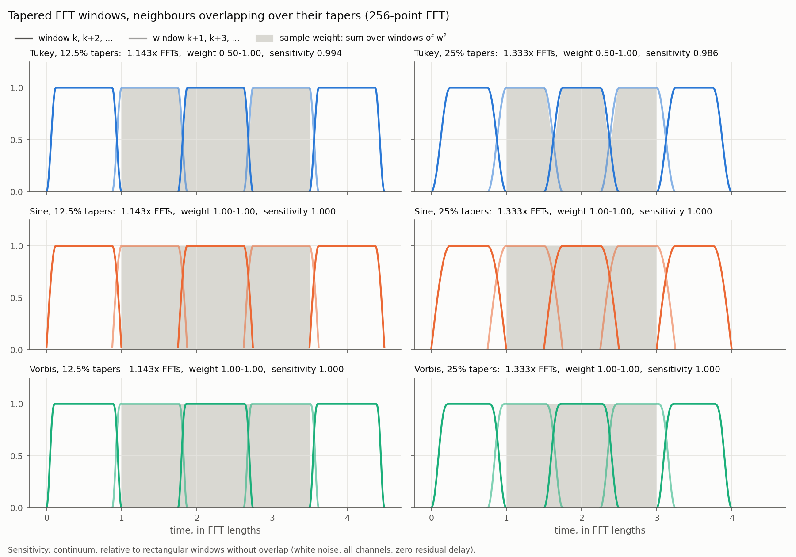
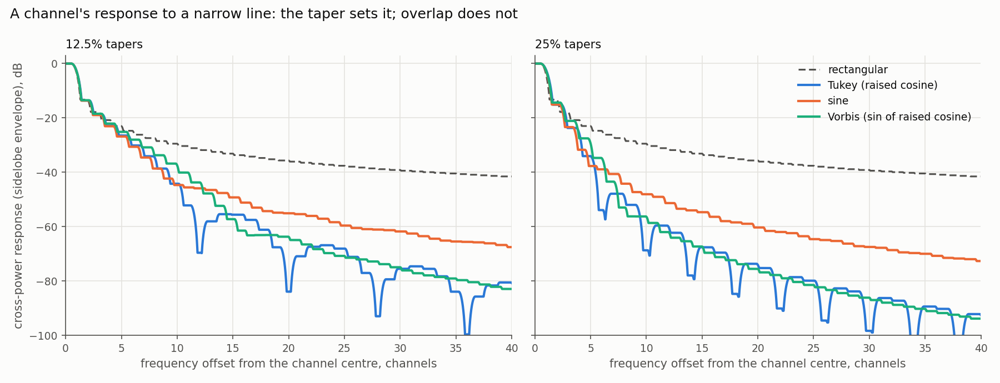

# fft-fusion: cuFFT + fractional-sample correction vs one fused cuFFTDx kernel

A standalone benchmark for the first step of `docs/gpu-window-pipeline-design.md` in difx
(gpudifx branch). That step fuses the FFT and the fractional-sample correction into one kernel
with cuFFTDx, with room to pull the pre-FFT steps in too. It times both ways of doing one
subint's FFTs and rotations, on synthetic data already in GPU memory, and checks that they
agree:

- **unfused**, mpifxcorr's structure: if the FFT input needs any preparation, a kernel writes it
  out as an FP32 buffer. Then one batched cuFFT plan per antenna, then the rotation kernel per
  antenna. `--rotator double` runs mpifxcorr's own `gpu_resultsrotatorMultiply`, copied
  verbatim into `unfused.cu` (the commit it was copied from is noted there). Otherwise the
  unfused pipeline uses the same fixed-point rotation as the fused kernel.
- **fused**: one cuFFTDx kernel per antenna. It loads the FFT input (FP32 or FP16, optionally
  windowed and overlapped) into registers as FP32, does an FP32 FFT in shared memory, rotates
  each channel, and writes only the channels the correlator uses, in FP32.
- **from the packed data** (`--input packed`): the same, but starting from 1, 2, 4 or 8-bit
  multi-channel VDIF, so that the decode, sideband handling and fringe rotation come first. The
  fused kernel then goes all the way from the packed bytes to fringe-rotated, channelised,
  fractional-sample-corrected spectra. The unfused pipeline with `--rotator double` is gpudifx
  today: its decode + fringe kernel (copied verbatim into `gpudecode_copy.cuh`), cuFFT and
  mpifxcorr's rotation, all with FP64 phases. Also timed: **two kernels**, decode + fringe into
  an FP16 or FP32 buffer, then the fused FFT + correction reading it.

Directions this follows (gpudifx, 2026-11-16):
- **Autocorrelations will move to the XMAC.** They are off by default (`--autocorr none`).
  `--autocorr band|full` restores mpifxcorr's in-rotation accumulation for comparison.
- **No per-element FP64 phases.** The fused kernel always uses the fixed-point rotator: each
  spectrum's phase slope and offset are computed once in double, and each channel's phase in
  64-bit fixed point.
- **FP16 out of decode and fringe rotation** (`--input fp16`). The FFT takes FP16 in and gives
  FP32 out (see "FP16 in, FP32 out" below).
- **A windowed overlap-add front end** (`--wola`): a window with 12.5% / 75% / 12.5%
  taper / flat / taper, each window overlapping each neighbour over its taper (25% of each
  window is overlapped, 12.5% at each end; consecutive windows start 87.5% of an FFT length
  apart), with Vorbis tapers, which lose no sensitivity. Tukey and sine tapers are options
  too. See "Window design" below.
- **Decode and fringe rotation in the same kernel, if it pays** (`--input packed`), against
  keeping the trip through global memory between fringe rotation and the FFT (two kernels).
  See "From the packed data" below.

## Build and run

With a gpudifx `setup.bash` sourced, `make -j8` is all that is needed. The Makefile takes CUDA
from `CUDAROOT` and the GPU architecture from the `-arch=sm_NN` in `NVCCFLAGS`. Without them it
falls back to the `nvcc` on `PATH` and the GPU that `nvidia-smi` reports. It prints what it
chose at the start of every build.

cuFFTDx is part of NVIDIA's header-only MathDx package. It is not in the CUDA toolkit, and
NVIDIA's licence does not let us commit it here. On the first build the Makefile downloads the
`nvidia-mathdx` 25.6.0 wheel from PyPI, checks its sha256 and unpacks it into
`mathdx-25.6.0/` (git-ignored). On a machine whose build nodes have no network access, run
`make mathdx` first on one that does (an OzSTAR login node). To use a MathDx you already have,
set `MATHDX` to the directory that holds `include/cufftdx.hpp` and `external/cutlass`. Tested
with MathDx 25.6.0 (cuFFTDx 1.5.0) and CUDA 13.2.

```bash
source <gpudifx>/setup.bash
make -j8                                                             # as setup.bash says
make -j8 SM=80                                                       # A100, whatever setup.bash says
make -j8 MATHDX=<mathdx dir> CUDA_HOME=/usr/local/cuda-13.2          # everything given explicitly
./fusebench --help
./fusebench --nchan 128 --nwin 10000 --input fp16 --wola --fpb sweep  # one case
./fusebench --nchan 128 --nwin 10000 --input packed --wola --ept sweep # from the packed data
./run-bench.sh                                                       # the standard set below
python3 window_response.py 256                                       # window design numbers
python3 plot_windows.py                                              # the plots in plots/
```

On OzSTAR: run `make mathdx` on a login node, then `sbatch fusebench-ozstar.sbatch` from
`fft-fusion`. The job sources your gpudifx setup (`DIFX_SETUP`, default
`$HOME/setup_difx.claude`: module loads, then `setup.bash`), builds for the GPU it gets and runs
`run-bench.sh`. Its header has the details. `ncu-ozstar.sbatch`, submitted the same way,
profiles the kernels with Nsight Compute (`--set full`) and packs the reports.

The fused kernel is compiled once per FFT length (`SIZES` in the Makefile, default 64 to
16384), in all its variants. That takes about 4 minutes with `-j8` (8 cores); `SIZES="256 2048"`
builds just the two the standard set uses. `fusebench` exits non-zero if a check fails.
`run-bench.sh` takes about 30 s and writes its logs to `results-local/<host>-<stamp>/`
(git-ignored).

The main options:
- shape: `--nant --nband --nchan`, and `--nwin`, the subint length in FFT lengths;
- `--complex` for complex sampling (real data use an FFT of 2 × nchan and keep the lower half);
- `--input fp32|fp16`;
- `--layout window|series`: one buffer per FFT window (mpifxcorr's layout), or one continuous
  series per antenna and band, which overlapping windows need;
- the window: `--taper F` (taper length at each end, as a fraction of the FFT length),
  `--overlap F` (the fraction of an FFT length consecutive windows share; the hop is 1 - F),
  `--window tukey|sine|vorbis` (taper shape), or `--wola` (`--taper 0.125 --overlap 0.125
  --window vorbis`; a `--window` given as well takes precedence);
- `--rotator`, `--autocorr`, `--fpb N|sweep` (FFTs per block of the fused kernel, default
  cuFFTDx's suggestion), `--batched` (one launch for all antennas), `--invalid F` (flag a
  fraction of the windows).

### Checks

Each run checks:
- that the fused and unfused spectra agree (relative rms < 1e-5). They are bit-identical when
  both use the same rotator;
- that both agree with a double-precision DFT and rotation of the *exact* input on 16 random
  spectra, and that the fused result is at least as close as the unfused one. "Exact" means the
  generated noise before it is rounded to the storage precision, times the window. FP32 input
  gives 2-3e-7 rms. FP16 input gives 2e-4 rms, which is FP16's own rounding (about -74 dB),
  far below the quantisation noise of 2- or 4-bit data;
- that the autocorrelations agree (relative rms < 1e-4), when they are on.

## Code layout: adding the pre-FFT steps

| file | what |
|---|---|
| `common.cuh` | `Geometry` (the `[ant][window][band][fftchannels]` layout of mpifxcorr's buffers), error macros |
| `stages.cuh` | the stages either side of the FFT: `PreLoad<T, SERIES>` (FP32/FP16 storage, per-window or series layout, optional window), `withPre()` (the one place stage types are instantiated); `FracRotateFixed` |
| `decode.cuh` | `PreDecode<TILED>`: decode, sideband sign and fixed-point fringe rotation from the packed data, as a pre-FFT stage |
| `gpudecode_copy.cuh` | gpudifx's decode helpers and tiled decode + fringe kernel, copied verbatim (the commit and the two changes are noted there) |
| `unfused.cu` | the copied production kernel, cuFFT plans as `GPUMode` makes them, the kernel that materialises a pre-FFT stage, the generic rotation kernel, the fixed-point phase precompute |
| `fused_inst.cu` | the fused kernel, compiled per FFT length; each length registers its variants (FFTs per block, and cuFFTDx's elements per thread or half of it) at start-up |
| `fusebench.cu` | data, window, checks, timing, options |
| `window_response.py` | sensitivity and spectral response of window designs |

Both pipelines are built from the same stage objects. A pre-FFT stage is a struct with
`operator()(geometry, ant, window, band, sample)` that returns the FP32 FFT input, plus
`sourceIndex()` and `weight()`, which the check uses to rebuild the exact input. The fused
kernel calls it while loading the FFT input. The unfused pipeline runs it as its own kernel
into an FP32 staging buffer, then runs cuFFT on that buffer. A stage can also be `staged`: the
whole block first fills shared memory (`stage()`), then each thread loads from there (`load()`);
the tiled decode works this way. For packed input the check decodes the bytes on the host with
its own decoder, rotates in double precision and does a DFT.

A note for that step: the series layout assumes the stage before the FFT produces one
continuous series per band. Each window then starts at its own sample (`window * hop`, and in
mpifxcorr plus its integer delay shift). Fringe rotation must then be a continuous function of
time, not a phase line fitted per window, because a sample in an overlap belongs to two
windows.

## FP16 in, FP32 out

cuFFTDx has no mixed-precision FFT. Its `Precision<>` is one type (`__half`, `float` or
`double`) for the whole transform, and `Precision<__half>` computes in FP16 and returns FP16.
It does not need one, though. With block execution the FFT works on values in registers, and
the loads from and stores to global memory are the caller's own code. The fused kernel loads
FP16, converts to FP32 in registers, does an FP32 FFT, and stores FP32. The memory saving is
all in the load, and the FFT itself is not the bottleneck. An FP16 FFT would compute at FP16
precision (unit roundoff 5e-4, with rounding error growing with the number of FFT stages) and
return FP16, for no speed gain in a kernel that is memory-bound.

## Results, 2026-11-16

`run-bench.sh`: 10 antennas, 8 bands, real data, 64 MHz bands, no autocorrelations. Median of
20 subints, ms per subint for all 10 antennas. Fused times are for the best FFTs-per-block
setting, with cuFFTDx's suggested setting in brackets where it differs. "vs mpifxcorr" is
relative to the first row: FP32 input, cuFFT, then mpifxcorr's rotation kernel. WOLA is 12.5%
tapers with hop 0.875 FFT lengths; "WOLA, hop 0.75" is the same window with consecutive windows
sharing 25% (`--overlap 0.25`), for comparison. The 2070 was timed with Tukey tapers, `--wola`'s
shape at the time, and the A100 with Vorbis tapers. The taper shape does not change the cost
(the window is a table of weights; Tukey, sine and Vorbis time the same).

### RTX 2070 SUPER

CUDA 13.2, cuFFT 12.2, cuFFTDx 1.5.0. 448 GB/s memory bandwidth, FP64 at 1/32 rate.

**128 channels** (256-point FFT), 20 ms subint (10000 FFT lengths):

| FFT input | windows | unfused: prep + cuFFT + rotation | unfused | fused | fused vs unfused | fused vs mpifxcorr |
|---|---|---|---|---|---|---|
| FP32, mpifxcorr's FP64 rotation | 10000 | 0 + 8.46 + 9.03 | 17.45 | 6.38 | 2.74 | **2.7** |
| FP32 | 10000 | 0 + 8.46 + 4.41 | 12.87 | 6.38 | 2.02 | **2.7** |
| FP16 | 10000 | 6.50 + 8.46 + 4.41 | 19.37 | 4.56 (4.70) | 4.24 | **3.8** |
| FP32, WOLA | 11428 | 9.09 + 9.67 + 5.03 | 23.79 | 7.33 (7.58) | 3.25 | **2.4** |
| FP16, WOLA | 11428 | 7.40 + 9.66 + 5.03 | 22.09 | 5.77 (6.12) | 3.83 | **3.0** |
| FP16, WOLA, hop 0.75 | 13333 | 8.30 + 11.27 + 5.87 | 25.43 | (6.94) | 3.67 | **2.5** |

**1024 channels** (2048-point FFT), 16 ms subint (1000 FFT lengths):

| FFT input | windows | unfused: prep + cuFFT + rotation | unfused | fused | fused vs unfused | fused vs mpifxcorr |
|---|---|---|---|---|---|---|
| FP32, mpifxcorr's FP64 rotation | 1000 | 0 + 6.78 + 7.22 | 14.00 | 5.01 | 2.79 | **2.8** |
| FP32 | 1000 | 0 + 6.78 + 3.41 | 10.19 | 5.01 | 2.03 | **2.8** |
| FP16 | 1000 | 5.20 + 6.78 + 3.41 | 15.39 | 3.53 | 4.36 | **4.0** |
| FP32, WOLA | 1142 | 7.26 + 7.74 + 3.89 | 18.89 | 6.23 | 3.03 | **2.2** |
| FP16, WOLA | 1142 | 5.84 + 7.74 + 3.89 | 17.47 | 4.72 (4.79) | 3.70 | **3.0** |
| FP16, WOLA, hop 0.75 | 1333 | 6.56 + 9.03 + 4.54 | 20.12 | (5.26) | 3.82 | **2.7** |

(The hop 0.75 rows were timed at the suggested setting only.)

#### What the numbers say

1. **Fused with FP32 input is 2.7-2.8x faster than mpifxcorr's FFT + rotation today.** That
   splits into two parts. Replacing the per-element FP64 phases with fixed point is worth
   1.35x on this card: mpifxcorr's rotation kernel is FP64-bound on the 2070 (84% of the FP64
   pipe, 32% of DRAM, Nsight Compute), because Turing runs FP64 at 1/32 rate. Fusion is worth
   another 2.0x. With fixed-point phases both pipelines are memory-bound, and fusion halves the
   traffic: cuFFT reads and writes every sample, and the rotation reads and writes half of them
   again. The fused kernel reads the input once and writes only the half that is used.
2. **FP16 input makes the fused kernel faster still: 3.8-4.0x vs mpifxcorr.** It reads half the
   bytes. The FP32 output is unchanged. Unfused, FP16 is slower than FP32, because cuFFT needs
   FP32 input and converting it is a full extra pass. A cuFFT load callback could avoid that
   pass; it is not tried here.
3. **WOLA costs 26-34% over the fused kernel without it**: 1.143x more windows, plus the series
   reads and the weights. Fused with FP16 input it is still 3.0x faster than mpifxcorr's FFT +
   rotation without any windowing. Unfused, it would cost 1.25-1.4x mpifxcorr's time.
   Overlapping by 25% of an FFT length between consecutive windows (hop 0.75) costs 10-13%
   more than overlapping just the tapers.
4. **FFTs per block matter.** One per block is bad for small FFTs (256 points). Above 16 KB of
   shared memory per block, the larger settings lose. cuFFTDx's suggestion is within about 6% of
   the best everywhere here.

### A100-SXM4-80GB (OzSTAR, gina7)

`fusebench-ozstar.sbatch`, SLURM job 21008444. CUDA 12.8, cuFFTDx 1.5.0. 2039 GB/s memory
bandwidth (4.6x the 2070), FP64 at 1/2 rate. Every check passed.

**128 channels** (256-point FFT), 20 ms subint (10000 FFT lengths):

| FFT input | windows | unfused: prep + cuFFT + rotation | unfused | fused | fused vs unfused | fused vs mpifxcorr |
|---|---|---|---|---|---|---|
| FP32, mpifxcorr's FP64 rotation | 10000 | 0 + 1.97 + 1.16 | 3.13 | 1.64 | 1.91 | **1.9** |
| FP32 | 10000 | 0 + 1.96 + 1.13 | 3.09 | 1.64 | 1.89 | **1.9** |
| FP16 | 10000 | 1.59 + 1.96 + 1.13 | 4.69 | 1.40 | 3.36 | **2.2** |
| FP32, WOLA | 11428 | 2.27 + 2.23 + 1.28 | 5.77 | 2.23 | 2.59 | **1.4** |
| FP16, WOLA | 11428 | 1.97 + 2.23 + 1.28 | 5.48 | 1.85 | 2.96 | **1.7** |
| FP16, WOLA, hop 0.75 | 13333 | 2.24 + 2.58 + 1.49 | 6.31 | (2.08) | 3.03 | **1.5** |

**1024 channels** (2048-point FFT), 16 ms subint (1000 FFT lengths):

| FFT input | windows | unfused: prep + cuFFT + rotation | unfused | fused | fused vs unfused | fused vs mpifxcorr |
|---|---|---|---|---|---|---|
| FP32, mpifxcorr's FP64 rotation | 1000 | 0 + 1.62 + 1.06 | 2.68 | 1.35 | 1.98 | **2.0** |
| FP32 | 1000 | 0 + 1.62 + 0.90 | 2.52 | 1.35 | 1.86 | **2.0** |
| FP16 | 1000 | 1.28 + 1.62 + 0.90 | 3.80 | 1.26 | 3.03 | **2.1** |
| FP32, WOLA | 1142 | 1.81 + 1.83 + 1.02 | 4.65 | 1.83 | 2.54 | **1.5** |
| FP16, WOLA | 1142 | 1.56 + 1.83 + 1.02 | 4.40 | 1.55 | 2.84 | **1.7** |
| FP16, WOLA, hop 0.75 | 1333 | 1.78 + 2.12 + 1.18 | 5.07 | (1.76) | 2.88 | **1.5** |

#### What changes on the A100

1. **Fused is 1.9-2.0x faster than mpifxcorr's FFT + rotation with FP32 input, 2.1-2.2x with
   FP16** (2070: 2.7-2.8x and 3.8-4.0x). The A100 runs mpifxcorr's FFT + rotation 5.2-5.6x
   faster than the 2070, but the fused kernel only 2.8-3.9x faster.
2. **Fixed-point phases gain little here; the gain is fusion.** With FP64 at half rate,
   mpifxcorr's rotation kernel takes about as long as the fixed-point one: 1.16 vs 1.13 ms at
   128 channels (2%), 1.06 vs 0.90 ms at 1024 (17%). Fixed-point phases still matter on cards
   with low-rate FP64, such as the 2070.
3. **With FP32 input the fused kernel is limited by memory bandwidth; with FP16 input, on the
   A100, it is not.** It must read each window's `fftchannels` complex input samples and write
   `nchan` FP32 complex channels: 2.46 GB per subint at 128 channels with FP32 input, 1.64 GB
   with FP16. With FP32 input that is 1.45-1.50 TB/s, 71-74% of the A100's 2039 GB/s, as fast
   as the fixed-point rotation kernel, a plain streaming kernel (1.45 TB/s, 71%); on the 2070
   86-88%, against the streaming kernel's 84-86% (Nsight Compute agrees: 89% DRAM throughput).
   With FP16 input it is 1.04-1.17 TB/s, 51-58%: FP16 moves 33% fewer bytes but saves only
   7-15% of the time on the A100 (29-30% on the 2070, 80-83% of its bandwidth). So only the
   FP16 path has room on the A100, up to about 1.3-1.4x. (Corrected: the first version of this
   paragraph, in 501bc92, counted the FP32 input at 4 bytes a sample instead of 8, and
   concluded wrongly that the FP32 kernel reached only 38-49%.)
4. **WOLA costs 23-36% over the fused kernel without it** (2070: 26-34%), and hop 0.75 another
   13-14% (2070: 10-13%). Fused with FP16 input, WOLA is still 1.7x faster than mpifxcorr's
   FFT + rotation without windowing; unfused it would cost 1.6-1.8x mpifxcorr's time.
5. **cuFFTDx's suggested FFTs per block was the best setting in every case.**
6. For this array (10 antennas, 8 x 64 MHz bands), the fused FP16 WOLA kernel runs at
   10.3-10.8x real time, mpifxcorr's FFT + rotation at 6.0-6.4x. That is this stage alone,
   without unpacking, fringe rotation, the cross-multiply or transfers.

### From the packed data: RTX 2070 SUPER

`run-bench.sh`, the `packed-*` cases: 2-bit, 8-band VDIF (8000-byte payloads), odd bands lower
sideband, an integer delay per antenna, a fringe phase slope and offset per window and band.
Best variant of each fused kernel (FFTs per block, elements per thread), ms per subint for all
10 antennas, all checks passing. The FFT stage of the 2-kernel rows is the better of cuFFTDx's
and half its elements per thread where both were timed (the WOLA columns). gpudifx's decode
kernel cannot apply a window, so the WOLA columns have no gpudifx rows.

| pipeline | 128 ch | 128 ch, WOLA | 1024 ch | 1024 ch, WOLA |
|---|---|---|---|---|
| gpudifx today: decode + fringe (FP64), cuFFT, rotation (FP64) | 13.52 + 8.45 + 9.26 = 31.18 | | 9.50 + 6.77 + 7.41 = 23.65 | |
| unfused, fixed-point phases | 21.15 | 24.10 | 16.06 | 18.18 |
| **end-to-end fused kernel** | **6.71** (4.6x) | **7.88** | **6.20** (3.8x) | **7.19** |
| 2 kernels: decode + fringe -> FP16, fused FFT | 3.78 + 4.72 = 8.46 | 4.33 + 5.21 = 9.54 | 2.69 + 3.56 = 6.32 | 3.05 + 4.92 = 7.94 |
| 2 kernels: decode + fringe -> FP32, fused FFT | 4.90 + 6.38 = 11.28 | 5.55 + 7.31 = 12.87 | 4.55 + 5.00 = 9.54 | 5.14 + 5.95 = 11.08 |
| 2 kernels: gpudifx's decode (FP64) -> FP32, fused FFT | 13.52 + 6.38 = 19.98 | | 9.50 + 5.00 = 14.61 | |
| end-to-end, tiled decode | 8.69 | | 6.29 | |

1. **On the 2070 the end-to-end kernel is the fastest: 4.6x gpudifx today at 128 channels,
   3.8x at 1024.** Against two kernels with an FP16 buffer between them it takes 21% less time
   at 128 channels (17% with WOLA), and 2% less at 1024 channels (9% with WOLA). WOLA costs the
   end-to-end kernel 16-17% (1.14x the windows). The A100 has 4.6x the memory bandwidth and
   about 2x the arithmetic, which makes the trip through memory relatively cheaper there: it
   needs measuring (`run-bench.sh`) before choosing. The first kernel of the pair was written
   for this comparison (one block per antenna and window, 8 samples per thread, unrolled, as in
   the fused kernel). At 128 channels it is still far from the write bandwidth (4.33 ms for
   0.94 GB with WOLA), so it may have more in it.
2. **Decode is half the end-to-end kernel**, not the FFT. Taking pieces out of it (128
   channels, no window, cuFFTDx's elements per thread): FFT + correction + store 3.02 ms; with
   fringe rotation 3.89; with the decode 7.58. Per sample the decode finds its frame, checks
   that the frame is valid and reads its bits, and that is long latency for little arithmetic
   (Nsight Compute: 49% of issue slots used, DRAM 22% busy, the main stalls instruction-cache
   misses and load latency).
3. **The tiled decode does not pay here.** Decoding the block's windows into shared memory with
   band on the lane (gpudifx's tiling) is slower at 128 channels (8.80 vs 6.75 ms) and level at
   1024. Its point in gpudifx is coalescing the stores; in the fused kernel the FFT's own layout
   already keeps the stores coalesced, and each window decodes only its own samples (a few
   bytes per sample time, read straight from the payload).
4. **cuFFTDx's suggested elements per thread is not the best.** Half of it (8 instead of 16 for
   both the 256- and 2048-point FFT on this card) takes 7-10% off the end-to-end kernel and 16%
   off the fused FFT of an FP16 buffer (WOLA, 128 channels: 6.15 -> 5.13 ms), against cuFFTDx's
   suggested setting. The variants are registered for both, and `--ept sweep` times them. The
   earlier tables for the FP32 and FP16 buffers were taken with cuFFTDx's setting only.
5. Other changes tried on the end-to-end kernel (128 channels):
   - kept: 32-bit sample numbers in the decode (gpudifx: 64-bit, whose division is a long
     software routine): -4%; 1- and 2-bit levels by arithmetic, not from `__constant__`
     memory: -2%
   - not kept: finding each window's frame once and stepping per sample: +12% (slower);
     one launch for all antennas: no change
   - not done yet: the bit width as a template parameter: -3 to -4% in a quick test, worth it
     in production code

### From the packed data: A100-SXM4-80GB (OzSTAR, gina10)

`fusebench-ozstar.sbatch`, SLURM job 21016518, commit 2247eaa; the same runs as on the 2070, all
checks passing. ms per subint.

| pipeline | 128 ch | 128 ch, WOLA | 1024 ch | 1024 ch, WOLA |
|---|---|---|---|---|
| gpudifx today: decode + fringe (FP64), cuFFT, rotation (FP64) | 3.09 + 1.96 + 1.15 = 6.19 | | 2.17 + 1.62 + 1.08 = 4.84 | |
| unfused, fixed-point phases | 5.99 | 6.82 | 4.77 | 5.42 |
| **end-to-end fused kernel** | **2.85** (2.2x) | **3.24** | 2.48 (2.0x) | **2.83** |
| 2 kernels: decode + fringe -> FP16, fused FFT | 1.65 + 1.39 = 3.02 | 1.88 + 1.73 = 3.60 | **1.18 + 1.25 = 2.43** | 1.34 + 1.63 = 2.97 |
| 2 kernels: decode + fringe -> FP32, fused FFT | 1.66 + 1.63 = 3.31 | 1.89 + 2.11 = 4.01 | 1.17 + 1.35 = 2.52 | 1.33 + 1.80 = 3.13 |
| 2 kernels: gpudifx's decode (FP64) -> FP32, fused FFT | 3.09 + 1.63 = 4.74 | | 2.17 + 1.35 = 3.52 | |
| end-to-end, tiled decode | 3.02 | | 2.48 | |

1. **The end-to-end kernel's lead shrinks on the A100, as expected.** Against two kernels with
   an FP16 buffer it takes 6% less time at 128 channels (10% with WOLA) and 5% less at 1024
   channels with WOLA; without a window at 1024 channels the two kernels are 2% faster. Against
   gpudifx today both are about 2x (2.2x at 128 channels, 2.0x at 1024); on the 2070 4.6x and
   3.8x, where gpudifx's FP64 phases cost far more.
2. **Decode + fringe rotation is not limited by bandwidth on the A100 either.** Writing FP16 or
   FP32 takes the same time (1.65 vs 1.66 ms at 128 channels), so the FP32 buffer costs only
   what its larger read costs the FFT kernel. The FP16 buffer still wins.
3. **Half of cuFFTDx's elements per thread** takes 7-10% off the end-to-end kernel and 8-10%
   off the fused FFT with WOLA (not with FP16 input at 1024 channels, where cuFFTDx's setting is
   best), as on the 2070. The tiled decode does best at 1 FFT per block, and there only matches
   the direct decode.
4. **For this array the end-to-end kernel with WOLA runs at 5.7-6.2x real time**, this stage
   alone.

What Nsight Compute shows (`ncu-ozstar.sbatch`, job 21016519; per antenna; ncu runs the GPU at
its base clock):
- **Occupancy is limited by registers.** The fused kernels use 64-72 registers a thread, which
  leaves 36-42% of the A100's warp slots active (81-98% on the 2070, whose SMs hold half as
  many threads). The main stall is waiting for loads (long scoreboard), with too few warps to
  hide it. Halving the elements per thread cuts registers to 48-56 and raises occupancy to
  51-61%, which is where its gain comes from. Next: cap the registers (`__launch_bounds__`
  with a minimum of blocks per SM) and measure.
- **The end-to-end kernel uses 3-10% of the memory bandwidth** and 49-68% of its issue slots,
  and executes 2.6-3.4x the instructions of the same kernel reading an FP32 buffer: decode and
  fringe rotation are about two-thirds of its instructions. Making it faster means fewer
  instructions per sample in the decode.
- **cuFFTDx's shared-memory exchange has bank conflicts** in every fused variant: 1.0-1.2M
  excess wavefronts per launch at 256 points, 4.1-4.7M at 2048 (the same on the 2070).
- The 128-channel profiles of this run (2000 windows, 33 MB of input per antenna) fit in the
  A100's 40 MB L2 cache, which understates their DRAM traffic; the job now profiles 10000.

### Window design

All the designs here overlap neighbouring windows over exactly their tapers (with 12.5% tapers,
consecutive windows start 0.875 FFT lengths apart). Three taper shapes, with x running from 0
to 1 across the taper:

- **Tukey**, the raised cosine 0.5 (1 - cos πx).
- **Sine**, sin(πx/2).
- **Vorbis**, sin(π/2 · raised cosine). This is the taper of the window used in Ogg Vorbis,
  and the `--wola` default.


Where two windows overlap, the cross-power weights each sample by the sum of the squares of the
two tapers.
- **Tukey tapers add up to one in amplitude, not in power**, so that weight dips to 0.5 in the
  middle of each overlap. This costs continuum sensitivity: 0.6% at 12.5% tapers, 1.4% at 25%.
  Shorter tapers lose less, but no Tukey width loses nothing, because the loss comes from the
  shape.
- **Sine and Vorbis tapers add up to one in power**, so every sample has weight 1 and there is
  no loss at any taper length.
- **The Vorbis taper is also smooth at both ends**, like the Tukey taper, so its far sidelobes
  fall off as fast as Tukey's. The sine taper's sidelobes fall off more slowly.




Longer tapers cut the leakage further and cost more FFTs, 1 / (1 - taper). At 12.5% the near
leakage (beyond 5 channels) is much the same for all three shapes, -23 to -27 dB, and the far
leakage (beyond 20 channels) is -59 to -60 dB for Tukey and Vorbis, against -47 dB for sine.
Between about 18% and 25%, Tukey's near leakage drops faster than the others' (-44 dB at 25%,
against -34 dB for sine and Vorbis), but Tukey then loses 1.4% of sensitivity.




Window shape alone sets how much correlation survives a residual delay; overlap sets the
sensitivity at zero delay. With 12.5% tapers each shape beats rectangular windows over a range
of residual delays (256-point FFT): Tukey from 2 to 43 samples, Vorbis from 1 to 52, sine from
1 to 69. The sine taper keeps the most correlation.

`window_response.py` gives these numbers for a 256-point FFT (continuum sensitivity relative to
rectangular windows without overlap; white noise; all channels). The spectral figures do not
depend on the FFT length.

| design | FFTs | sensitivity, delay 0 / 4 / 16 samples | leakage beyond 5 / 20 channels |
|---|---|---|---|
| rectangular, no overlap (mpifxcorr now) | 1.000 | 1.000 / 0.984 / 0.938 | -16.9 / -23.0 dB |
| Tukey 12.5% | 1.143 | 0.994 / 0.991 / 0.955 | -25.0 / -60.4 dB |
| sine 12.5% | 1.143 | 1.000 / 0.997 / 0.965 | -26.6 / -47.2 dB |
| Vorbis 12.5% (`--wola`) | 1.143 | 1.000 / 0.997 / 0.957 | -23.4 / -59.2 dB |
| Tukey 25% | 1.333 | 0.986 / 0.984 / 0.960 | -44.2 / -71.2 dB |
| sine 25% | 1.333 | 1.000 / 0.998 / 0.977 | -34.4 / -52.8 dB |
| Vorbis 25% | 1.333 | 1.000 / 0.998 / 0.970 | -34.2 / -70.7 dB |
| Tukey 12.5%, hop 0.75 | 1.333 | 0.972 / 0.969 / 0.934 | -25.0 / -60.4 dB |
| Hann, 50% overlap | 2.000 | 0.973 / 0.972 / 0.949 | -53.5 / -83.7 dB |

The "hop 0.75" row places Tukey 12.5% tapers 0.75 FFT lengths apart, so the flat parts of the
overlaps are counted twice (weights 1 to 2). It costs more and does worse on every measure here.

**Choosing.** For no loss of continuum sensitivity at any taper length, use the Vorbis taper.
It keeps the Tukey taper's far-sidelobe suppression. At 12.5% it costs 1.143x the FFTs
(`--wola`). Going to 25% improves the near leakage by about 11 dB and the far
leakage by about 11 dB, for 17% more windows: 10-13% more fused-kernel time on the 2070 (the
"hop 0.75" rows in the results above have the same window count). The window is a table of
weights, so the shape costs nothing; only the taper length (the number of windows) does.
All of these are `fusebench` options (`--taper`, `--overlap`, `--window tukey|sine|vorbis`).

### Not yet measured

- Capping the fused kernels' registers for occupancy on the A100 (see the Nsight Compute
  findings above), and fewer instructions per sample in the decode.
- Two kernels with WOLA through a series buffer (each sample decoded, rotated and stored once,
  as `--layout series`) rather than a buffer per window, which repeats the 12.5% overlap. That
  needs the fringe phase to be continuous from window to window.
- Fringe and fractional-sample phases by recurrence (one sincos per thread, then a complex
  multiply per element) instead of a sincos per element.
- Complex packed data, phase cal, and CODIF in the end-to-end kernel.
- Complex data (`--complex`) and other channel counts.
- Decode and fringe rotation inside the fused kernel (the next pre-FFT stage).
- The effect inside mpifxcorr, where the FFT and rotation overlap with transfers and the XMAC.
