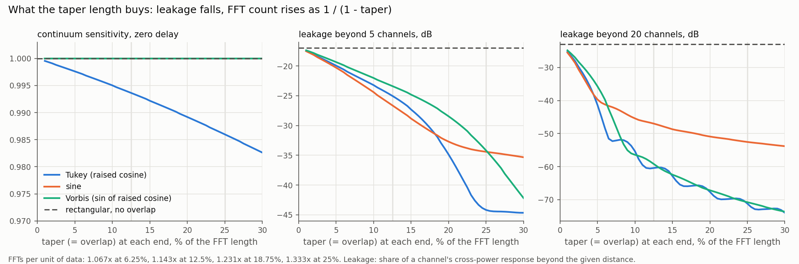

# fft-fusion: cuFFT + fractional-sample correction vs one fused cuFFTDx kernel

A standalone benchmark for the first step of `docs/gpu-window-pipeline-design.md` in difx
(gpudifx branch). That step fuses the FFT and the fractional-sample correction into one kernel
with cuFFTDx, with room to pull the pre-FFT steps in too. It times both ways of doing one
subint's FFTs and rotations, on synthetic data already in GPU memory, and checks that they
agree:

- **unfused**, mpifxcorr's structure: if the FFT input needs any preparation, a kernel writes it
  out as an FP32 buffer. Then one batched cuFFT plan per antenna, then the rotation kernel per
  antenna. `--rotator double` runs mpifxcorr's own `gpu_resultsrotatorMultiply`, copied
  verbatim into `unfused.cu` (the commit it was copied from is noted there). Otherwise the
  unfused pipeline uses the same fixed-point rotation as the fused kernel.
- **fused**: one cuFFTDx kernel per antenna. It loads the FFT input (FP32 or FP16, optionally
  windowed and overlapped) into registers as FP32, does an FP32 FFT in shared memory, rotates
  each channel, and writes only the channels the correlator uses, in FP32.

Directions this follows (gpudifx, 2026-11-16):
- **Autocorrelations will move to the XMAC.** They are off by default (`--autocorr none`).
  `--autocorr band|full` restores mpifxcorr's in-rotation accumulation for comparison.
- **No per-element FP64 phases.** The fused kernel always uses the fixed-point rotator: each
  spectrum's phase slope and offset are computed once in double, and each channel's phase in
  64-bit fixed point.
- **FP16 out of decode and fringe rotation** (`--input fp16`). The FFT takes FP16 in and gives
  FP32 out (see "FP16 in, FP32 out" below).
- **A windowed overlap-add front end** (`--wola`): a window with 12.5% / 75% / 12.5%
  taper / flat / taper, each window overlapping each neighbour over its taper (25% of each
  window is overlapped, 12.5% at each end; consecutive windows start 87.5% of an FFT length
  apart), with Vorbis tapers, which lose no sensitivity. Tukey and sine tapers are options
  too. See "Window design" below.

## Build and run

With a gpudifx `setup.bash` sourced, `make -j8` is all that is needed. The Makefile takes CUDA
from `CUDAROOT` and the GPU architecture from the `-arch=sm_NN` in `NVCCFLAGS`. Without them it
falls back to the `nvcc` on `PATH` and the GPU that `nvidia-smi` reports. It prints what it
chose at the start of every build.

cuFFTDx is part of NVIDIA's header-only MathDx package. It is not in the CUDA toolkit, and
NVIDIA's licence does not let us commit it here. On the first build the Makefile downloads the
`nvidia-mathdx` 25.6.0 wheel from PyPI, checks its sha256 and unpacks it into
`mathdx-25.6.0/` (git-ignored). On a machine whose build nodes have no network access, run
`make mathdx` first on one that does (an OzSTAR login node). To use a MathDx you already have,
set `MATHDX` to the directory that holds `include/cufftdx.hpp` and `external/cutlass`. Tested
with MathDx 25.6.0 (cuFFTDx 1.5.0) and CUDA 13.2.

```bash
source <gpudifx>/setup.bash
make -j8                                                             # as setup.bash says
make -j8 SM=80                                                       # A100, whatever setup.bash says
make -j8 MATHDX=<mathdx dir> CUDA_HOME=/usr/local/cuda-13.2          # everything given explicitly
./fusebench --help
./fusebench --nchan 128 --nwin 10000 --input fp16 --wola --fpb sweep  # one case
./run-bench.sh                                                       # the standard set below
python3 window_response.py 256                                       # window design numbers
python3 plot_windows.py                                              # the plots in plots/
```

On OzSTAR: run `make mathdx` on a login node, then `sbatch fusebench-ozstar.sbatch` from
`fft-fusion`. The job sources your gpudifx setup (`DIFX_SETUP`, default
`$HOME/setup_difx.claude`: module loads, then `setup.bash`), builds for the GPU it gets and runs
`run-bench.sh`. Its header has the details.

The fused kernel is compiled once per FFT length (`SIZES` in the Makefile, default 64 to
16384). That takes about a minute with `-j8`. `fusebench` exits non-zero if a check fails.
`run-bench.sh` takes about 30 s and writes its logs to `results-local/<host>-<stamp>/`
(git-ignored).

The main options:
- shape: `--nant --nband --nchan`, and `--nwin`, the subint length in FFT lengths;
- `--complex` for complex sampling (real data use an FFT of 2 × nchan and keep the lower half);
- `--input fp32|fp16`;
- `--layout window|series`: one buffer per FFT window (mpifxcorr's layout), or one continuous
  series per antenna and band, which overlapping windows need;
- the window: `--taper F` (taper length at each end, as a fraction of the FFT length),
  `--overlap F` (the fraction of an FFT length consecutive windows share; the hop is 1 - F),
  `--window tukey|sine|vorbis` (taper shape), or `--wola` (`--taper 0.125 --overlap 0.125
  --window vorbis`; a `--window` given as well takes precedence);
- `--rotator`, `--autocorr`, `--fpb N|sweep` (FFTs per block of the fused kernel, default
  cuFFTDx's suggestion), `--batched` (one launch for all antennas), `--invalid F` (flag a
  fraction of the windows).

### Checks

Each run checks:
- that the fused and unfused spectra agree (relative rms < 1e-5). They are bit-identical when
  both use the same rotator;
- that both agree with a double-precision DFT and rotation of the *exact* input on 16 random
  spectra, and that the fused result is at least as close as the unfused one. "Exact" means the
  generated noise before it is rounded to the storage precision, times the window. FP32 input
  gives 2-3e-7 rms. FP16 input gives 2e-4 rms, which is FP16's own rounding (about -74 dB),
  far below the quantisation noise of 2- or 4-bit data;
- that the autocorrelations agree (relative rms < 1e-4), when they are on.

## Code layout: adding the pre-FFT steps

| file | what |
|---|---|
| `common.cuh` | `Geometry` (the `[ant][window][band][fftchannels]` layout of mpifxcorr's buffers), error macros |
| `stages.cuh` | the stages either side of the FFT: `PreLoad<T, SERIES>` (FP32/FP16 storage, per-window or series layout, optional window), `withPre()` (the one place stage types are instantiated); `FracRotateFixed` |
| `unfused.cu` | the copied production kernel, cuFFT plans as `GPUMode` makes them, the kernel that materialises a pre-FFT stage, the generic rotation kernel, the fixed-point phase precompute |
| `fused_inst.cu` | the fused kernel, compiled per FFT length; each length registers its FFTs-per-block variants at start-up |
| `fusebench.cu` | data, window, checks, timing, options |
| `window_response.py` | sensitivity and spectral response of window designs |

Both pipelines are built from the same stage objects. A pre-FFT stage is a struct with
`operator()(geometry, ant, window, band, sample)` that returns the FP32 FFT input, plus
`sourceIndex()` and `weight()`, which the check uses to rebuild the exact input. The fused
kernel calls it while loading the FFT input. The unfused pipeline runs it as its own kernel
into an FP32 staging buffer, then runs cuFFT on that buffer. To try decode + fringe rotation in
the kernel, write a stage struct that reads the packed samples, and add it to `withPre()`.

A note for that step: the series layout assumes the stage before the FFT produces one
continuous series per band. Each window then starts at its own sample (`window * hop`, and in
mpifxcorr plus its integer delay shift). Fringe rotation must then be a continuous function of
time, not a phase line fitted per window, because a sample in an overlap belongs to two
windows.

## FP16 in, FP32 out

cuFFTDx has no mixed-precision FFT. Its `Precision<>` is one type (`__half`, `float` or
`double`) for the whole transform, and `Precision<__half>` computes in FP16 and returns FP16.
It does not need one, though. With block execution the FFT works on values in registers, and
the loads from and stores to global memory are the caller's own code. The fused kernel loads
FP16, converts to FP32 in registers, does an FP32 FFT, and stores FP32. The memory saving is
all in the load, and the FFT itself is not the bottleneck. An FP16 FFT would compute at FP16
precision (unit roundoff 5e-4, with rounding error growing with the number of FFT stages) and
return FP16, for no speed gain in a kernel that is memory-bound.

## Results: RTX 2070 SUPER, 2026-11-16

CUDA 13.2, cuFFT 12.2, cuFFTDx 1.5.0. 10 antennas, 8 bands, real data, 64 MHz bands, no
autocorrelations. Median of 20 subints, ms per subint for all 10 antennas. Fused times are for
the best FFTs-per-block setting, with cuFFTDx's suggested setting in brackets where it differs.
"vs mpifxcorr" is relative to the first row: FP32 input, cuFFT, then mpifxcorr's rotation
kernel. WOLA is 12.5% tapers with hop 0.875 FFT lengths; "WOLA, hop 0.75" is the same window
with consecutive windows sharing 25% (`--overlap 0.25`), for comparison. These were timed with
Tukey tapers, `--wola`'s shape at the time. The taper shape does not change the cost (the window
is a table of weights; Tukey, sine and Vorbis time the same).

**128 channels** (256-point FFT), 20 ms subint (10000 FFT lengths):

| FFT input | windows | unfused: prep + cuFFT + rotation | unfused | fused | fused vs unfused | fused vs mpifxcorr |
|---|---|---|---|---|---|---|
| FP32, mpifxcorr's FP64 rotation | 10000 | 0 + 8.46 + 9.03 | 17.45 | 6.38 | 2.74 | **2.7** |
| FP32 | 10000 | 0 + 8.46 + 4.41 | 12.87 | 6.38 | 2.02 | **2.7** |
| FP16 | 10000 | 6.50 + 8.46 + 4.41 | 19.37 | 4.56 (4.70) | 4.24 | **3.8** |
| FP32, WOLA | 11428 | 9.09 + 9.67 + 5.03 | 23.79 | 7.33 (7.58) | 3.25 | **2.4** |
| FP16, WOLA | 11428 | 7.40 + 9.66 + 5.03 | 22.09 | 5.77 (6.12) | 3.83 | **3.0** |
| FP16, WOLA, hop 0.75 | 13333 | 8.30 + 11.27 + 5.87 | 25.43 | (6.94) | 3.67 | **2.5** |

**1024 channels** (2048-point FFT), 16 ms subint (1000 FFT lengths):

| FFT input | windows | unfused: prep + cuFFT + rotation | unfused | fused | fused vs unfused | fused vs mpifxcorr |
|---|---|---|---|---|---|---|
| FP32, mpifxcorr's FP64 rotation | 1000 | 0 + 6.78 + 7.22 | 14.00 | 5.01 | 2.79 | **2.8** |
| FP32 | 1000 | 0 + 6.78 + 3.41 | 10.19 | 5.01 | 2.03 | **2.8** |
| FP16 | 1000 | 5.20 + 6.78 + 3.41 | 15.39 | 3.53 | 4.36 | **4.0** |
| FP32, WOLA | 1142 | 7.26 + 7.74 + 3.89 | 18.89 | 6.23 | 3.03 | **2.2** |
| FP16, WOLA | 1142 | 5.84 + 7.74 + 3.89 | 17.47 | 4.72 (4.79) | 3.70 | **3.0** |
| FP16, WOLA, hop 0.75 | 1333 | 6.56 + 9.03 + 4.54 | 20.12 | (5.26) | 3.82 | **2.7** |

(The hop 0.75 rows were timed at the suggested setting only.)

### What the numbers say

1. **Fused with FP32 input is 2.7-2.8x faster than mpifxcorr's FFT + rotation today.** That
   splits into two parts. Replacing the per-element FP64 phases with fixed point is worth
   1.35x on this card: mpifxcorr's rotation kernel is FP64-bound on the 2070 (84% of the FP64
   pipe, 32% of DRAM, Nsight Compute), because Turing runs FP64 at 1/32 rate. Fusion is worth
   another 2.0x. With fixed-point phases both pipelines are memory-bound, and fusion halves the
   traffic: cuFFT reads and writes every sample, and the rotation reads and writes half of them
   again. The fused kernel reads the input once and writes only the half that is used.
2. **FP16 input makes the fused kernel faster still: 3.8-4.0x vs mpifxcorr.** It reads half the
   bytes. The FP32 output is unchanged. Unfused, FP16 is slower than FP32, because cuFFT needs
   FP32 input and converting it is a full extra pass. A cuFFT load callback could avoid that
   pass; it is not tried here.
3. **WOLA costs 26-34% over the fused kernel without it**: 1.143x more windows, plus the series
   reads and the weights. Fused with FP16 input it is still 3.0x faster than mpifxcorr's FFT +
   rotation without any windowing. Unfused, it would cost 1.25-1.4x mpifxcorr's time.
   Overlapping by 25% of an FFT length between consecutive windows (hop 0.75) costs 10-13%
   more than overlapping just the tapers.
4. **FFTs per block matter.** One per block is bad for small FFTs (256 points). Above 16 KB of
   shared memory per block, the larger settings lose. cuFFTDx's suggestion is within about 6% of
   the best everywhere here.

### Window design

All the designs here overlap neighbouring windows over exactly their tapers (with 12.5% tapers,
consecutive windows start 0.875 FFT lengths apart). Three taper shapes, with x running from 0
to 1 across the taper:

- **Tukey**, the raised cosine 0.5 (1 - cos πx).
- **Sine**, sin(πx/2).
- **Vorbis**, sin(π/2 · raised cosine). This is the taper of the window used in Ogg Vorbis,
  and the `--wola` default.


Where two windows overlap, the cross-power weights each sample by the sum of the squares of the
two tapers.
- **Tukey tapers add up to one in amplitude, not in power**, so that weight dips to 0.5 in the
  middle of each overlap. This costs continuum sensitivity: 0.6% at 12.5% tapers, 1.4% at 25%.
  Shorter tapers lose less, but no Tukey width loses nothing, because the loss comes from the
  shape.
- **Sine and Vorbis tapers add up to one in power**, so every sample has weight 1 and there is
  no loss at any taper length.
- **The Vorbis taper is also smooth at both ends**, like the Tukey taper, so its far sidelobes
  fall off as fast as Tukey's. The sine taper's sidelobes fall off more slowly.




Longer tapers cut the leakage further and cost more FFTs, 1 / (1 - taper). At 12.5% the near
leakage (beyond 5 channels) is much the same for all three shapes, -23 to -27 dB, and the far
leakage (beyond 20 channels) is -59 to -60 dB for Tukey and Vorbis, against -47 dB for sine.
Between about 18% and 25%, Tukey's near leakage drops faster than the others' (-44 dB at 25%,
against -34 dB for sine and Vorbis), but Tukey then loses 1.4% of sensitivity.


Window shape alone sets how much correlation survives a residual delay; overlap sets the
sensitivity at zero delay. With 12.5% tapers each shape beats rectangular windows over a range
of residual delays (256-point FFT): Tukey from 2 to 43 samples, Vorbis from 1 to 52, sine from
1 to 69. The sine taper keeps the most correlation.

`window_response.py` gives these numbers for a 256-point FFT (continuum sensitivity relative to
rectangular windows without overlap; white noise; all channels). The spectral figures do not
depend on the FFT length.

| design | FFTs | sensitivity, delay 0 / 4 / 16 samples | leakage beyond 5 / 20 channels |
|---|---|---|---|
| rectangular, no overlap (mpifxcorr now) | 1.000 | 1.000 / 0.984 / 0.938 | -16.9 / -23.0 dB |
| Tukey 12.5% | 1.143 | 0.994 / 0.991 / 0.955 | -25.0 / -60.4 dB |
| sine 12.5% | 1.143 | 1.000 / 0.997 / 0.965 | -26.6 / -47.2 dB |
| Vorbis 12.5% (`--wola`) | 1.143 | 1.000 / 0.997 / 0.957 | -23.4 / -59.2 dB |
| Tukey 25% | 1.333 | 0.986 / 0.984 / 0.960 | -44.2 / -71.2 dB |
| sine 25% | 1.333 | 1.000 / 0.998 / 0.977 | -34.4 / -52.8 dB |
| Vorbis 25% | 1.333 | 1.000 / 0.998 / 0.970 | -34.2 / -70.7 dB |
| Tukey 12.5%, hop 0.75 | 1.333 | 0.972 / 0.969 / 0.934 | -25.0 / -60.4 dB |
| Hann, 50% overlap | 2.000 | 0.973 / 0.972 / 0.949 | -53.5 / -83.7 dB |

The "hop 0.75" row places Tukey 12.5% tapers 0.75 FFT lengths apart, so the flat parts of the
overlaps are counted twice (weights 1 to 2). It costs more and does worse on every measure here.

**Choosing.** For no loss of continuum sensitivity at any taper length, use the Vorbis taper.
It keeps the Tukey taper's far-sidelobe suppression. At 12.5% it costs 1.143x the FFTs
(`--wola`). Going to 25% improves the near leakage by about 11 dB and the far
leakage by about 11 dB, for 17% more windows: 10-13% more fused-kernel time on the 2070 (the
"hop 0.75" rows in the results above have the same window count). The window is a table of
weights, so the shape costs nothing; only the taper length (the number of windows) does.
All of these are `fusebench` options (`--taper`, `--overlap`, `--window tukey|sine|vorbis`).

### Not yet measured

- **The A100** (`fusebench-ozstar.sbatch`). FP64 runs at half rate there and memory bandwidth
  is 3.5x higher.
- Complex data (`--complex`) and other channel counts.
- Decode and fringe rotation inside the fused kernel (the next pre-FFT stage).
- The effect inside mpifxcorr, where the FFT and rotation overlap with transfers and the XMAC.
