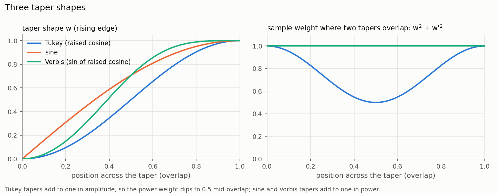
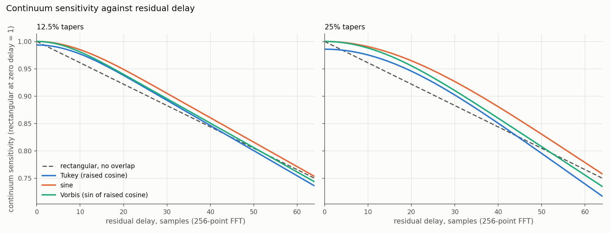

# fft-fusion: cuFFT + fractional-sample correction vs one fused cuFFTDx kernel

A standalone benchmark for the first step of `docs/gpu-window-pipeline-design.md` in difx
(gpudifx branch). That step fuses the FFT and the fractional-sample correction into one kernel
with cuFFTDx, with room to pull the pre-FFT steps in too. It times both ways of doing one
subint's FFTs and rotations, on synthetic data already in GPU memory, and checks that they
agree:

- **unfused**, mpifxcorr's structure: if the FFT input needs any preparation, a kernel writes it
  out as an FP32 buffer. Then one batched cuFFT plan per antenna, then the rotation kernel per
  antenna. `--rotator double` runs mpifxcorr's own `gpu_resultsrotatorMultiply`, copied
  verbatim into `unfused.cu` (the commit it was copied from is noted there). Otherwise the
  unfused pipeline uses the same fixed-point rotation as the fused kernel.
- **fused**: one cuFFTDx kernel per antenna. It loads the FFT input (FP32 or FP16, optionally
  windowed and overlapped) into registers as FP32, does an FP32 FFT in shared memory, rotates
  each channel, and writes only the channels the correlator uses, in FP32.
- **from the packed data** (`--input packed`): the same, but starting from 1, 2, 4 or 8-bit
  multi-channel VDIF, so that the decode, sideband handling and fringe rotation come first. The
  fused kernel then goes all the way from the packed bytes to fringe-rotated, channelised,
  fractional-sample-corrected spectra. The unfused pipeline with `--rotator double` is gpudifx
  today: its decode + fringe kernel (copied verbatim into `gpudecode_copy.cuh`), cuFFT and
  mpifxcorr's rotation, all with FP64 phases. Also timed: **two kernels**, decode + fringe into
  an FP16 or FP32 buffer, then the fused FFT + correction reading it.
- **the cross-multiply** (`xmacbench`, a separate program): the XMAC stage on its own, from
  station spectra in the layout the fused kernel writes. gpudifx's kernel (copied verbatim into
  `xmac_copy.cuh`), a register-tiled FP32 kernel, and a tensor-core kernel (FP16 in, FP32 sums)
  with the transpose into its layout. See "The XMAC stage" below.

Directions this follows (gpudifx, 2026-11-16):
- **Autocorrelations will move to the XMAC.** They are off by default (`--autocorr none`).
  `--autocorr band|full` restores mpifxcorr's in-rotation accumulation for comparison.
- **No per-element FP64 phases.** The fused kernel always uses the fixed-point rotator: each
  spectrum's phase slope and offset are computed once in double, and each channel's phase in
  64-bit fixed point.
- **FP16 out of decode and fringe rotation** (`--input fp16`). The FFT takes FP16 in and gives
  FP32 out (see "FP16 in, FP32 out" below).
- **A windowed overlap-add front end** (`--wola`): a window with 12.5% / 75% / 12.5%
  taper / flat / taper, each window overlapping each neighbour over its taper (25% of each
  window is overlapped, 12.5% at each end; consecutive windows start 87.5% of an FFT length
  apart), with Vorbis tapers, which lose no sensitivity. Tukey and sine tapers are options
  too. See "Window design" below.
- **Decode and fringe rotation in the same kernel, if it pays** (`--input packed`), against
  keeping the trip through global memory between fringe rotation and the FFT (two kernels).
  See "From the packed data" below.

## Build and run

With a gpudifx `setup.bash` sourced, `make -j8` is all that is needed. The Makefile takes CUDA
from `CUDAROOT` and the GPU architecture from the `-arch=sm_NN` in `NVCCFLAGS`. Without them it
falls back to the `nvcc` on `PATH` and the GPU that `nvidia-smi` reports. It prints what it
chose at the start of every build.

cuFFTDx is part of NVIDIA's header-only MathDx package. It is not in the CUDA toolkit, and
NVIDIA's licence does not let us commit it here. On the first build the Makefile downloads the
`nvidia-mathdx` 25.6.0 wheel from PyPI, checks its sha256 and unpacks it into
`mathdx-25.6.0/` (git-ignored). On a machine whose build nodes have no network access, run
`make mathdx` first on one that does (an OzSTAR login node). To use a MathDx you already have,
set `MATHDX` to the directory that holds `include/cufftdx.hpp` and `external/cutlass`. Tested
with MathDx 25.6.0 (cuFFTDx 1.5.0) and CUDA 13.2.

```bash
source <gpudifx>/setup.bash
make -j8                                                             # as setup.bash says
make -j8 SM=80                                                       # A100, whatever setup.bash says
make -j8 MATHDX=<mathdx dir> CUDA_HOME=/usr/local/cuda-13.2          # everything given explicitly
./fusebench --help
./fusebench --nchan 128 --nwin 10000 --input fp16 --wola --fpb sweep  # one case
./fusebench --nchan 128 --nwin 10000 --input packed --wola --ept sweep # from the packed data
./run-bench.sh                                                       # the standard set below
./run-nchan.sh                                                       # cost against channel count
./xmacbench --nant 10                                                # the XMAC stage, 10 stations
./run-xmac.sh                                                        # XMAC against the number of stations
python3 window_response.py 256                                       # window design numbers
python3 plot_windows.py                                              # the plots in plots/
```

On OzSTAR: run `make mathdx` on a login node, then `sbatch fusebench-ozstar.sbatch` from
`fft-fusion`. The job sources your gpudifx setup (`DIFX_SETUP`, default
`$HOME/setup_difx.claude`: module loads, then `setup.bash`), builds for the GPU it gets and runs
`run-bench.sh`, `run-nchan.sh` and `run-xmac.sh`. Its header has the details.
`ncu-ozstar.sbatch`, submitted the same way, profiles the kernels with Nsight Compute (`--set
full`) and packs the reports.

The fused kernel is compiled once per FFT length (`SIZES` in the Makefile, default 64 to
16384), in all its variants. That takes about 4 minutes with `-j8` (8 cores); `SIZES="256 2048"`
builds just the two the standard set uses. `fusebench` exits non-zero if a check fails.
`run-bench.sh` takes about 30 s and writes its logs to `results-local/<host>-<stamp>/`
(git-ignored).

The main options:
- shape: `--nant --nband --nchan`, and `--nwin`, the subint length in FFT lengths;
- `--complex` for complex sampling (real data use an FFT of 2 × nchan and keep the lower half);
- `--input fp32|fp16`;
- `--layout window|series`: one buffer per FFT window (mpifxcorr's layout), or one continuous
  series per antenna and band, which overlapping windows need;
- the window: `--taper F` (taper length at each end, as a fraction of the FFT length),
  `--overlap F` (the fraction of an FFT length consecutive windows share; the hop is 1 - F),
  `--window tukey|sine|vorbis` (taper shape), or `--wola` (`--taper 0.125 --overlap 0.125
  --window vorbis`; a `--window` given as well takes precedence);
- `--rotator`, `--autocorr`, `--fpb N|sweep` (FFTs per block of the fused kernel, default
  cuFFTDx's suggestion), `--batched` (one launch for all antennas), `--invalid F` (flag a
  fraction of the windows);
- `--xmac` (packed 2-bit input, lean decode, dual polarisation): the XMAC after the station
  processing, including the end-to-end kernel writing the tensor XMAC's layout itself.

### Checks

Each run checks:
- that the fused and unfused spectra agree (relative rms < 1e-5). They are bit-identical when
  both use the same rotator;
- that both agree with a double-precision DFT and rotation of the *exact* input on 16 random
  spectra, and that the fused result is at least as close as the unfused one. "Exact" means the
  generated noise before it is rounded to the storage precision, times the window. FP32 input
  gives 2-3e-7 rms. FP16 input gives 2e-4 rms, which is FP16's own rounding (about -74 dB),
  far below the quantisation noise of 2- or 4-bit data;
- that the autocorrelations agree (relative rms < 1e-4), when they are on.

## Code layout: adding the pre-FFT steps

| file | what |
|---|---|
| `common.cuh` | `Geometry` (the `[ant][window][band][fftchannels]` layout of mpifxcorr's buffers), error macros |
| `stages.cuh` | the stages either side of the FFT: `PreLoad<T, SERIES>` (FP32/FP16 storage, per-window or series layout, optional window), `withPre()` (the one place stage types are instantiated); `FracRotateFixed` |
| `decode.cuh` | decode, sideband sign and fixed-point fringe rotation from the packed data, as pre-FFT stages: `PreDecodeLean<NBIT>` (the default) and `PreDecode` (gpudifx's per-sample arithmetic, `--decode direct`); the per-window descriptor (`WinDesc`) |
| `gpudecode_copy.cuh` | gpudifx's decode helpers and tiled decode + fringe kernel, copied verbatim (the commit and the two changes are noted there) |
| `unfused.cu` | the copied production kernel, cuFFT plans as `GPUMode` makes them, the kernel that materialises a pre-FFT stage, the generic rotation kernel, the fixed-point phase precompute, and for packed input the fringe phases and window descriptors (`launchPackedSetup`) |
| `fused_inst.cu` | the fused kernel, compiled per FFT length; each length registers its variants (FFTs per block, and cuFFTDx's elements per thread or half of it) at start-up |
| `fusebench.cu` | data, window, checks, timing, options |
| `xmac.cuh`, `xmac.cu` | the XMAC stage: the shapes and layouts, the three versions |
| `xmac_copy.cuh` | gpudifx's XMAC kernel, copied verbatim, and its launch geometry as GPUCore sets it |
| `xmacbench.cu` | the XMAC benchmark: station spectra with a common signal, the double-precision check, timing |
| `window_response.py` | sensitivity and spectral response of window designs |

Both pipelines are built from the same stage objects. A pre-FFT stage is a struct with
`operator()(geometry, ant, window, band, sample)` that returns the FP32 FFT input, plus
`sourceIndex()` and `weight()`, which the check uses to rebuild the exact input. For the kernels
whose threads each work on one spectrum (the fused kernel, and the 2-kernel pipeline's
`decode_to`) it also has `prepare(geometry, ant, window, band)`, called once per thread for
everything that depends only on the window and band, and `at(state, ..., sample)` per sample.
The unfused pipeline runs it as its own kernel into an FP32 staging buffer, then runs cuFFT on
that buffer. For packed input the check decodes the bytes on the host with its own decoder,
rotates in double precision and does a DFT, and requires both pipelines to be within 1e-5 rms of
that (they are within a few 1e-7). `--bad-frames F` flags a fraction of the VDIF frames invalid,
to test the decode's handling of them. (A tiled decode, the block decoding into shared memory
with band on the lane as gpudifx's kernel does, was measured below and removed: it never beat
the direct decode, and it cost build time.)

A note for that step: the series layout assumes the stage before the FFT produces one
continuous series per band. Each window then starts at its own sample (`window * hop`, and in
mpifxcorr plus its integer delay shift). Fringe rotation must then be a continuous function of
time, not a phase line fitted per window, because a sample in an overlap belongs to two
windows.

## FP16 in, FP32 out

cuFFTDx has no mixed-precision FFT. Its `Precision<>` is one type (`__half`, `float` or
`double`) for the whole transform, and `Precision<__half>` computes in FP16 and returns FP16.
It does not need one, though. With block execution the FFT works on values in registers, and
the loads from and stores to global memory are the caller's own code. The fused kernel loads
FP16, converts to FP32 in registers, does an FP32 FFT, and stores FP32. The memory saving is
all in the load, and the FFT itself is not the bottleneck. An FP16 FFT would compute at FP16
precision (unit roundoff 5e-4, with rounding error growing with the number of FFT stages) and
return FP16, for no speed gain in a kernel that is memory-bound.

## Results, 2026-11-16

`run-bench.sh`: 10 antennas, 8 bands, real data, 64 MHz bands, no autocorrelations. Median of
20 subints, ms per subint for all 10 antennas. Fused times are for the best FFTs-per-block
setting, with cuFFTDx's suggested setting in brackets where it differs. "vs mpifxcorr" is
relative to the first row: FP32 input, cuFFT, then mpifxcorr's rotation kernel. WOLA is 12.5%
tapers with hop 0.875 FFT lengths; "WOLA, hop 0.75" is the same window with consecutive windows
sharing 25% (`--overlap 0.25`), for comparison. The 2070 was timed with Tukey tapers, `--wola`'s
shape at the time, and the A100 with Vorbis tapers. The taper shape does not change the cost
(the window is a table of weights; Tukey, sine and Vorbis time the same).

### RTX 2070 SUPER

CUDA 13.2, cuFFT 12.2, cuFFTDx 1.5.0. 448 GB/s memory bandwidth, FP64 at 1/32 rate.

**128 channels** (256-point FFT), 20 ms subint (10000 FFT lengths):

| FFT input | windows | unfused: prep + cuFFT + rotation | unfused | fused | fused vs unfused | fused vs mpifxcorr |
|---|---|---|---|---|---|---|
| FP32, mpifxcorr's FP64 rotation | 10000 | 0 + 8.46 + 9.03 | 17.45 | 6.38 | 2.74 | **2.7** |
| FP32 | 10000 | 0 + 8.46 + 4.41 | 12.87 | 6.38 | 2.02 | **2.7** |
| FP16 | 10000 | 6.50 + 8.46 + 4.41 | 19.37 | 4.56 (4.70) | 4.24 | **3.8** |
| FP32, WOLA | 11428 | 9.09 + 9.67 + 5.03 | 23.79 | 7.33 (7.58) | 3.25 | **2.4** |
| FP16, WOLA | 11428 | 7.40 + 9.66 + 5.03 | 22.09 | 5.77 (6.12) | 3.83 | **3.0** |
| FP16, WOLA, hop 0.75 | 13333 | 8.30 + 11.27 + 5.87 | 25.43 | (6.94) | 3.67 | **2.5** |

**1024 channels** (2048-point FFT), 16 ms subint (1000 FFT lengths):

| FFT input | windows | unfused: prep + cuFFT + rotation | unfused | fused | fused vs unfused | fused vs mpifxcorr |
|---|---|---|---|---|---|---|
| FP32, mpifxcorr's FP64 rotation | 1000 | 0 + 6.78 + 7.22 | 14.00 | 5.01 | 2.79 | **2.8** |
| FP32 | 1000 | 0 + 6.78 + 3.41 | 10.19 | 5.01 | 2.03 | **2.8** |
| FP16 | 1000 | 5.20 + 6.78 + 3.41 | 15.39 | 3.53 | 4.36 | **4.0** |
| FP32, WOLA | 1142 | 7.26 + 7.74 + 3.89 | 18.89 | 6.23 | 3.03 | **2.2** |
| FP16, WOLA | 1142 | 5.84 + 7.74 + 3.89 | 17.47 | 4.72 (4.79) | 3.70 | **3.0** |
| FP16, WOLA, hop 0.75 | 1333 | 6.56 + 9.03 + 4.54 | 20.12 | (5.26) | 3.82 | **2.7** |

(The hop 0.75 rows were timed at the suggested setting only.)

#### What the numbers say

1. **Fused with FP32 input is 2.7-2.8x faster than mpifxcorr's FFT + rotation today.** That
   splits into two parts. Replacing the per-element FP64 phases with fixed point is worth
   1.35x on this card: mpifxcorr's rotation kernel is FP64-bound on the 2070 (84% of the FP64
   pipe, 32% of DRAM, Nsight Compute), because Turing runs FP64 at 1/32 rate. Fusion is worth
   another 2.0x. With fixed-point phases both pipelines are memory-bound, and fusion halves the
   traffic: cuFFT reads and writes every sample, and the rotation reads and writes half of them
   again. The fused kernel reads the input once and writes only the half that is used.
2. **FP16 input makes the fused kernel faster still: 3.8-4.0x vs mpifxcorr.** It reads half the
   bytes. The FP32 output is unchanged. Unfused, FP16 is slower than FP32, because cuFFT needs
   FP32 input and converting it is a full extra pass. A cuFFT load callback could avoid that
   pass; it is not tried here.
3. **WOLA costs 26-34% over the fused kernel without it**: 1.143x more windows, plus the series
   reads and the weights. Fused with FP16 input it is still 3.0x faster than mpifxcorr's FFT +
   rotation without any windowing. Unfused, it would cost 1.25-1.4x mpifxcorr's time.
   Overlapping by 25% of an FFT length between consecutive windows (hop 0.75) costs 10-13%
   more than overlapping just the tapers.
4. **FFTs per block matter.** One per block is bad for small FFTs (256 points). Above 16 KB of
   shared memory per block, the larger settings lose. cuFFTDx's suggestion is within about 6% of
   the best everywhere here.

### A100-SXM4-80GB (OzSTAR, gina7)

`fusebench-ozstar.sbatch`, SLURM job 21008444. CUDA 12.8, cuFFTDx 1.5.0. 2039 GB/s memory
bandwidth (4.6x the 2070), FP64 at 1/2 rate. Every check passed.

**128 channels** (256-point FFT), 20 ms subint (10000 FFT lengths):

| FFT input | windows | unfused: prep + cuFFT + rotation | unfused | fused | fused vs unfused | fused vs mpifxcorr |
|---|---|---|---|---|---|---|
| FP32, mpifxcorr's FP64 rotation | 10000 | 0 + 1.97 + 1.16 | 3.13 | 1.64 | 1.91 | **1.9** |
| FP32 | 10000 | 0 + 1.96 + 1.13 | 3.09 | 1.64 | 1.89 | **1.9** |
| FP16 | 10000 | 1.59 + 1.96 + 1.13 | 4.69 | 1.40 | 3.36 | **2.2** |
| FP32, WOLA | 11428 | 2.27 + 2.23 + 1.28 | 5.77 | 2.23 | 2.59 | **1.4** |
| FP16, WOLA | 11428 | 1.97 + 2.23 + 1.28 | 5.48 | 1.85 | 2.96 | **1.7** |
| FP16, WOLA, hop 0.75 | 13333 | 2.24 + 2.58 + 1.49 | 6.31 | (2.08) | 3.03 | **1.5** |

**1024 channels** (2048-point FFT), 16 ms subint (1000 FFT lengths):

| FFT input | windows | unfused: prep + cuFFT + rotation | unfused | fused | fused vs unfused | fused vs mpifxcorr |
|---|---|---|---|---|---|---|
| FP32, mpifxcorr's FP64 rotation | 1000 | 0 + 1.62 + 1.06 | 2.68 | 1.35 | 1.98 | **2.0** |
| FP32 | 1000 | 0 + 1.62 + 0.90 | 2.52 | 1.35 | 1.86 | **2.0** |
| FP16 | 1000 | 1.28 + 1.62 + 0.90 | 3.80 | 1.26 | 3.03 | **2.1** |
| FP32, WOLA | 1142 | 1.81 + 1.83 + 1.02 | 4.65 | 1.83 | 2.54 | **1.5** |
| FP16, WOLA | 1142 | 1.56 + 1.83 + 1.02 | 4.40 | 1.55 | 2.84 | **1.7** |
| FP16, WOLA, hop 0.75 | 1333 | 1.78 + 2.12 + 1.18 | 5.07 | (1.76) | 2.88 | **1.5** |

#### What changes on the A100

1. **Fused is 1.9-2.0x faster than mpifxcorr's FFT + rotation with FP32 input, 2.1-2.2x with
   FP16** (2070: 2.7-2.8x and 3.8-4.0x). The A100 runs mpifxcorr's FFT + rotation 5.2-5.6x
   faster than the 2070, but the fused kernel only 2.8-3.9x faster.
2. **Fixed-point phases gain little here; the gain is fusion.** With FP64 at half rate,
   mpifxcorr's rotation kernel takes about as long as the fixed-point one: 1.16 vs 1.13 ms at
   128 channels (2%), 1.06 vs 0.90 ms at 1024 (17%). Fixed-point phases still matter on cards
   with low-rate FP64, such as the 2070.
3. **With FP32 input the fused kernel is limited by memory bandwidth; with FP16 input, on the
   A100, it is not.** It must read each window's `fftchannels` complex input samples and write
   `nchan` FP32 complex channels: 2.46 GB per subint at 128 channels with FP32 input, 1.64 GB
   with FP16. With FP32 input that is 1.45-1.50 TB/s, 71-74% of the A100's 2039 GB/s, as fast
   as the fixed-point rotation kernel, a plain streaming kernel (1.45 TB/s, 71%); on the 2070
   86-88%, against the streaming kernel's 84-86% (Nsight Compute agrees: 89% DRAM throughput).
   With FP16 input it is 1.04-1.17 TB/s, 51-58%: FP16 moves 33% fewer bytes but saves only
   7-15% of the time on the A100 (29-30% on the 2070, 80-83% of its bandwidth). So only the
   FP16 path has room on the A100, up to about 1.3-1.4x. (Corrected: the first version of this
   paragraph, in 501bc92, counted the FP32 input at 4 bytes a sample instead of 8, and
   concluded wrongly that the FP32 kernel reached only 38-49%.)
4. **WOLA costs 23-36% over the fused kernel without it** (2070: 26-34%), and hop 0.75 another
   13-14% (2070: 10-13%). Fused with FP16 input, WOLA is still 1.7x faster than mpifxcorr's
   FFT + rotation without windowing; unfused it would cost 1.6-1.8x mpifxcorr's time.
5. **cuFFTDx's suggested FFTs per block was the best setting in every case.**
6. For this array (10 antennas, 8 x 64 MHz bands), the fused FP16 WOLA kernel runs at
   10.3-10.8x real time, mpifxcorr's FFT + rotation at 6.0-6.4x. That is this stage alone,
   without unpacking, fringe rotation, the cross-multiply or transfers.

### From the packed data: RTX 2070 SUPER

`run-bench.sh`, the `packed-*` cases: 2-bit, 8-band VDIF (8000-byte payloads), odd bands lower
sideband, an integer delay per antenna, a fringe phase slope and offset per window and band.
Best variant of each fused kernel (FFTs per block, elements per thread), ms per subint for all
10 antennas, all checks passing. The FFT stage of the 2-kernel rows is the better of cuFFTDx's
and half its elements per thread where both were timed (the WOLA columns). gpudifx's decode
kernel cannot apply a window, so the WOLA columns have no gpudifx rows.

| pipeline | 128 ch | 128 ch, WOLA | 1024 ch | 1024 ch, WOLA |
|---|---|---|---|---|
| gpudifx today: decode + fringe (FP64), cuFFT, rotation (FP64) | 13.52 + 8.45 + 9.26 = 31.18 | | 9.50 + 6.77 + 7.41 = 23.65 | |
| unfused, fixed-point phases | 21.15 | 24.10 | 16.06 | 18.18 |
| **end-to-end fused kernel** | **6.71** (4.6x) | **7.88** | **6.20** (3.8x) | **7.19** |
| 2 kernels: decode + fringe -> FP16, fused FFT | 3.78 + 4.72 = 8.46 | 4.33 + 5.21 = 9.54 | 2.69 + 3.56 = 6.32 | 3.05 + 4.92 = 7.94 |
| 2 kernels: decode + fringe -> FP32, fused FFT | 4.90 + 6.38 = 11.28 | 5.55 + 7.31 = 12.87 | 4.55 + 5.00 = 9.54 | 5.14 + 5.95 = 11.08 |
| 2 kernels: gpudifx's decode (FP64) -> FP32, fused FFT | 13.52 + 6.38 = 19.98 | | 9.50 + 5.00 = 14.61 | |
| end-to-end, tiled decode | 8.69 | | 6.29 | |

1. **On the 2070 the end-to-end kernel is the fastest: 4.6x gpudifx today at 128 channels,
   3.8x at 1024.** Against two kernels with an FP16 buffer between them it takes 21% less time
   at 128 channels (17% with WOLA), and 2% less at 1024 channels (9% with WOLA). WOLA costs the
   end-to-end kernel 16-17% (1.14x the windows). The A100 has 4.6x the memory bandwidth and
   about 2x the arithmetic, which makes the trip through memory relatively cheaper there: it
   needs measuring (`run-bench.sh`) before choosing. The first kernel of the pair was written
   for this comparison (one block per antenna and window, 8 samples per thread, unrolled, as in
   the fused kernel). At 128 channels it is still far from the write bandwidth (4.33 ms for
   0.94 GB with WOLA), so it may have more in it.
2. **Decode is half the end-to-end kernel**, not the FFT. Taking pieces out of it (128
   channels, no window, cuFFTDx's elements per thread): FFT + correction + store 3.02 ms; with
   fringe rotation 3.89; with the decode 7.58. Per sample the decode finds its frame, checks
   that the frame is valid and reads its bits, and that is long latency for little arithmetic
   (Nsight Compute: 49% of issue slots used, DRAM 22% busy, the main stalls instruction-cache
   misses and load latency).
3. **The tiled decode does not pay here.** Decoding the block's windows into shared memory with
   band on the lane (gpudifx's tiling) is slower at 128 channels (8.80 vs 6.75 ms) and level at
   1024. Its point in gpudifx is coalescing the stores; in the fused kernel the FFT's own layout
   already keeps the stores coalesced, and each window decodes only its own samples (a few
   bytes per sample time, read straight from the payload).
4. **cuFFTDx's suggested elements per thread is not the best.** Half of it (8 instead of 16 for
   both the 256- and 2048-point FFT on this card) takes 7-10% off the end-to-end kernel and 16%
   off the fused FFT of an FP16 buffer (WOLA, 128 channels: 6.15 -> 5.13 ms), against cuFFTDx's
   suggested setting. The variants are registered for both, and `--ept sweep` times them. The
   earlier tables for the FP32 and FP16 buffers were taken with cuFFTDx's setting only.
5. Other changes tried on the end-to-end kernel (128 channels):
   - kept: 32-bit sample numbers in the decode (gpudifx: 64-bit, whose division is a long
     software routine): -4%; 1- and 2-bit levels by arithmetic, not from `__constant__`
     memory: -2%
   - not kept: finding each window's frame once and stepping per sample: +12% (slower);
     one launch for all antennas: no change
   - not done yet: the bit width as a template parameter: -3 to -4% in a quick test, worth it
     in production code

### Channel count, chunks and register caps: RTX 2070 SUPER

**A correction first.** Commit 36f5b28, which added the register caps, also changed the
uncapped kernel's `__launch_bounds__(threads)` to `__launch_bounds__(threads, 1)`. That should
mean the same thing, but the compiler then gave the kernel more registers (A100: 86-96 instead
of 64-72 at cuFFTDx's elements per thread; 2070: 92-96 instead of 64-80), and some variants
became up to 38% slower on the A100 (56% with the tiled decode). The 2070 tables of that commit
and the A100 run of it (gina303) have the slower uncapped kernels. The uncapped kernel
is now declared as before, and its registers and times are back to those of 501bc92 (within 2%
on the 2070). In a few cases the extra registers had been faster (2070, 2 kernels FP16, WOLA:
10.11 vs 10.44 ms at 128 channels).

The 2070's times vary by about 5% from run to run with its temperature (it is a desktop card),
so compare within a table, not across them.

**Channel count** (`run-nchan.sh`): the same 20 ms of data (2,560,000 samples per antenna and
band) for every channel count, from the packed data, best variant of each pipeline; ms per
subint (lower is better), and the end-to-end kernel relative to 128 channels.

| nchan | windows | end-to-end | 2 kernels, FP16 | 2 kernels, FP32 | end-to-end, WOLA | 2 kernels FP16, WOLA | end-to-end vs 128 ch |
|---|---|---|---|---|---|---|---|
| 32 | 40000 | 6.57 | 9.04 | 12.71 | 7.71 | 10.48 | 0.97 |
| 64 | 20000 | 7.12 | 8.93 | 11.98 | 8.27 | 11.14 | 1.05 |
| 128 | 10000 | 6.77 | 8.51 | 11.27 | 7.92 | 10.55 | 1 |
| 256 | 5000 | 6.81 | 7.94 | 11.52 | 7.86 | 9.29 | 1.01 |
| 512 | 2500 | 7.58 | 7.91 | 11.61 | 8.94 | 9.77 | 1.12 |
| 1024 | 1250 | 7.95 | 7.89 | 11.88 | 9.32 | 9.90 | 1.17 |
| 2048 | 625 | 9.07 | 8.70 | 12.65 | 10.31 | 10.40 | 1.34 |
| 4096 | 312 | 10.45 | 12.46 | 15.94 | 12.04 | 15.67 | 1.54 |
| 8192 | 156 | 12.19 | 13.64 | 16.87 | 14.40 | 17.18 | 1.80 |

(4096 and 8192 channels: 19.97 ms of data, whole windows.) There is no case for a minimum
channel count: 32 channels cost the same as 256. Larger FFTs cost more per unit of data, gently
up to 1024 channels (+17%), then steeply (+34% at 2048, +54% at 4096, +80% at 8192). That is
an argument for two-stage channelisation at high resolution (see the open items). The 2-kernel
pipeline with an FP16 buffer is 38% behind at 32 channels, level at 512-1024 and 4% ahead at
2048, then behind again.

**Chunks** (`--chunk W`): W windows at a time, each antenna on its own stream so that the
antennas' chunks run together, each antenna's part of the 2-kernel buffer reused for every
chunk. All the antennas' chunks are in flight at once, which is what an XMAC reading the
spectra from L2 would need; the chunk sizes give 84, 21, 10.5, 5.2 and 2.6 MB in FP16 at both
channel counts. WOLA, half of cuFFTDx's elements per thread, ms per subint (each row from its
own run; the whole-subint times of those runs agree within 6%):

| chunk (windows) | in flight, FP16 | end-to-end | 2 kernels, FP16 | 2 kernels, FP32 |
|---|---|---|---|---|
| 128 channels: whole subint | | 8.02 | 9.91 | 12.78 |
| 1024 | 84 MB | 8.31 | 10.34 | 13.00 |
| 256 | 21 MB | 8.40 | 10.96 | 13.69 |
| 128 | 10.5 MB | 8.60 | 11.27 | 14.37 |
| 64 | 5.2 MB | 8.85 | 11.98 | 14.81 |
| 32 | 2.6 MB | 9.47 | 13.35 | 15.52 |
| 1024 channels: whole subint | | 7.51 | 8.61 | 11.13 |
| 128 | 84 MB | 7.92 | 8.42 | 10.87 |
| 32 | 21 MB | 7.80 | 8.89 | 11.39 |
| 16 | 10.5 MB | 7.94 | 9.14 | 11.54 |
| 8 | 5.2 MB | 8.19 | 12.73 | 13.94 |
| 4 | 2.6 MB | 8.54 | 18.78 | 19.51 |

Running the antennas together removes most of the cost of chunking: the end-to-end kernel loses
4-18%, against 32% for chunks of 256 windows one antenna at a time (the first version of
`--chunk`). The only chunked 2-kernel time below its whole-subint time is at 84 MB and 1024
channels, 20 times the 2070's 4 MB L2, so it comes from the decode and FFT kernels of
different antennas overlapping, not from L2. Chunks small enough for the 2070's L2 (2.6 MB) are
so small that launches dominate (1024 channels, 4 windows: 5700 launches per subint). So the
2070 cannot show what L2 is worth; the A100 (40 MB) can.

**Register caps** (`--regcap 1024|1536`): `__launch_bounds__` with a minimum of blocks per SM,
to raise occupancy on the A100. A 2070 SM holds only 1024 threads, so a cap allows at most 64
registers there. That changes nothing at half of cuFFTDx's elements per thread (55-58
registers either way). At cuFFTDx's setting it takes some variants from 72-80 registers to 64,
which moves their times by -6% to +5%; none of them is the fastest variant.

### Channel count, chunks and register caps: A100-SXM4-80GB (OzSTAR, gina4)

`fusebench-ozstar.sbatch`, SLURM job 21042592, commit 89b4dfb (the corrected uncapped kernel and
the concurrent chunks), all 30 runs and the channel-count sweep passing their checks; Nsight
Compute `ncu-ozstar.sbatch`, job 21038155 on gina304, commit d74abd3. The uncapped and 2-kernel
times agree with those of job 21016518 (gina10, below) within 0.1%, so that table stands. An
earlier run of the register caps (jobs 21021335 and 21021345, gina303, commit 36f5b28) had the
slower uncapped kernel described above; its capped times agree with these.

**Channel count** (`run-nchan.sh`), as for the 2070: 20 ms of data per antenna and band, from
the packed data, best variant of each pipeline (no register caps), ms per subint.

| nchan | windows | end-to-end | 2 kernels, FP16 | 2 kernels, FP32 | end-to-end, WOLA | 2 kernels FP16, WOLA | end-to-end vs 128 ch |
|---|---|---|---|---|---|---|---|
| 32 | 40000 | 2.58 | 3.08 | 3.36 | 2.95 | 3.78 | 0.90 |
| 64 | 20000 | 2.90 | 3.11 | 3.35 | 3.30 | 3.83 | 1.02 |
| 128 | 10000 | 2.86 | 3.03 | 3.30 | 3.24 | 3.79 | 1 |
| 256 | 5000 | 2.86 | 2.93 | 3.21 | 3.25 | 3.45 | 1.00 |
| 512 | 2500 | 3.28 | 3.36 | 3.28 | 3.75 | 3.89 | 1.15 |
| 1024 | 1250 | 3.07 | 3.01 | 3.10 | 3.51 | 3.68 | 1.08 |
| 2048 | 625 | 3.70 | 3.31 | 3.29 | 4.15 | 4.09 | 1.30 |
| 4096 | 312 | 4.14 | 3.93 | 4.82 | 4.77 | 4.60 | 1.45 |
| 8192 | 156 | 4.44 | 4.81 | 4.85 | 5.26 | 5.60 | 1.56 |

- **The step at 512 channels comes from the variants built, not the GPU.** At 1024 points
  cuFFTDx suggests 32 elements per thread (127 registers), so the sweep's choices there are 32
  and 16 (72 registers); at 256 and 1024 channels the fastest variant uses 8. Building a quarter
  of cuFFTDx's elements per thread as well would probably put 512 channels near 2.9 ms. (The
  sweep of the buggy build had 3.83 ms here.)
- **As on the 2070, nothing argues for a minimum channel count**, and longer FFTs cost more:
  +30% at 2048 channels, +56% at 8192, less steep than the 2070's +34% and +80%.
- **From 1024 channels up the 2 kernels catch the end-to-end kernel**, and with an FP16 buffer
  pass it at 2048 and 4096, with or without WOLA (2048 channels, no window: 3.31 against 3.70
  ms); at 8192 the end-to-end kernel is ahead again. Below 512 channels it takes 2-16% less time
  than the 2 kernels without a window and 6-22% less with WOLA.

**Chunks** (`--chunk W`, all antennas' chunks in flight at once, as for the 2070): WOLA, half of
cuFFTDx's elements per thread, ms per subint. The whole-subint times of the ten runs agree
within 0.1%.

| chunk (windows) | in flight, FP16 | end-to-end | 2 kernels, FP16 | 2 kernels, FP32 |
|---|---|---|---|---|
| 128 channels: whole subint | | 3.30 | 3.60 | 4.02 |
| 1024 | 84 MB | 3.27 | 3.69 | 4.23 |
| 256 | 21 MB | 3.46 | 3.87 | 4.60 |
| 128 | 10.5 MB | 3.64 | 3.74 | 4.04 |
| 64 | 5.2 MB | 4.17 | 7.11 | 7.13 |
| 32 | 2.6 MB | 9.87 | 19.08 | 16.33 |
| 1024 channels: whole subint | | 2.83 | 3.02 | 3.14 |
| 128 | 84 MB | 2.77 | 3.01 | 3.22 |
| 32 | 21 MB | 2.85 | 3.60 | 3.94 |
| 16 | 10.5 MB | 2.93 | 5.15 | 5.43 |
| 8 | 5.2 MB | 4.23 | 9.33 | 9.32 |
| 4 | 2.6 MB | 8.03 | 17.30 | 17.06 |

**Keeping the 2-kernel buffer in L2 does not pay.** With chunks that fit the 40 MB L2 (21 MB
and less in FP16), the 2-kernel pipeline is 4-7% slower than without chunks at 128 channels and
19% or more at 1024, never faster. Below about 10 MB the launches dominate. The 2 kernels are
not limited by memory bandwidth to begin with (Nsight Compute: the decode kernel uses 24% of the
DRAM bandwidth, the fused FFT reading FP16 43%), so taking the buffer's round trip out of DRAM
saves little; their deficit is the work of a second pass. Chunking the pre-processing for its
own sake is not worth it; any case for chunks has to come from the XMAC. The end-to-end kernel
loses nothing in chunks of 84 MB and 1-5% at 21 MB.

**Register caps** (`--regcap`, packed data with WOLA, ms per subint; `wola-fp16` is the fused FFT
reading an FP16 buffer):

| | 128 ch | 1024 ch |
|---|---|---|
| end-to-end, cuFFTDx's elements per thread: uncapped (72 reg) / cap 64 reg | 3.54 / 3.36 | 3.06 / 2.97 |
| end-to-end, half of them: uncapped (48-56 reg) / **cap 40 reg** | 3.24 / **3.03** | 2.83 / **2.76** |
| `wola-fp16`, half: uncapped (48 reg) / cap 54 reg (1024) / cap 40 reg (1536) | 1.70 / 1.79 / 1.97 | |

(best FFTs per block of each row.) Capping pays only where the decode is in the kernel: 40
registers at half of cuFFTDx's elements per thread gives the fastest end-to-end kernel, 6.5%
ahead of uncapped at 128 channels and 2.4% at 1024. A cap of 64 at cuFFTDx's setting gains 3-5%
but stays behind. For the fused FFT on its own the caps cost time (a cap of 40 at cuFFTDx's
setting: 3.92 against 1.85 ms).

What Nsight Compute shows now (job 21038155; ncu runs the GPU at its base clock):
- The corrected uncapped kernels have 64-72 registers and 40-47% occupancy at cuFFTDx's
  elements per thread (86-96 and 28-30% in the buggy build), and run 5-17% faster per launch
  than they did there (end-to-end, 128 channels, WOLA: 390 against 472 µs).
- **The end-to-end kernel is limited by instruction issue, not memory.** It uses 9-13% of the
  DRAM bandwidth and 55-68% of its issue slots, and executes 3.1-3.4x the instructions of the
  fused FFT reading an FP32 buffer (116-126M against 37M per antenna at 128 channels). At 1024
  channels with half of cuFFTDx's elements per thread (61% occupancy), the stalls for an issue
  slot (not selected) and for the arithmetic pipes (math pipe throttle) are rising towards the
  load stalls (long scoreboard). Fewer decode instructions per sample is the lever.

### From the packed data: A100-SXM4-80GB (OzSTAR, gina10)

`fusebench-ozstar.sbatch`, SLURM job 21016518, commit 2247eaa; the same runs as on the 2070, all
checks passing. ms per subint.

| pipeline | 128 ch | 128 ch, WOLA | 1024 ch | 1024 ch, WOLA |
|---|---|---|---|---|
| gpudifx today: decode + fringe (FP64), cuFFT, rotation (FP64) | 3.09 + 1.96 + 1.15 = 6.19 | | 2.17 + 1.62 + 1.08 = 4.84 | |
| unfused, fixed-point phases | 5.99 | 6.82 | 4.77 | 5.42 |
| **end-to-end fused kernel** | **2.85** (2.2x) | **3.24** | 2.48 (2.0x) | **2.83** |
| 2 kernels: decode + fringe -> FP16, fused FFT | 1.65 + 1.39 = 3.02 | 1.88 + 1.73 = 3.60 | **1.18 + 1.25 = 2.43** | 1.34 + 1.63 = 2.97 |
| 2 kernels: decode + fringe -> FP32, fused FFT | 1.66 + 1.63 = 3.31 | 1.89 + 2.11 = 4.01 | 1.17 + 1.35 = 2.52 | 1.33 + 1.80 = 3.13 |
| 2 kernels: gpudifx's decode (FP64) -> FP32, fused FFT | 3.09 + 1.63 = 4.74 | | 2.17 + 1.35 = 3.52 | |
| end-to-end, tiled decode | 3.02 | | 2.48 | |

1. **The end-to-end kernel's lead shrinks on the A100, as expected.** Against two kernels with
   an FP16 buffer it takes 6% less time at 128 channels (10% with WOLA) and 5% less at 1024
   channels with WOLA; without a window at 1024 channels the two kernels are 2% faster. Against
   gpudifx today both are about 2x (2.2x at 128 channels, 2.0x at 1024); on the 2070 4.6x and
   3.8x, where gpudifx's FP64 phases cost far more.
2. **Decode + fringe rotation is not limited by bandwidth on the A100 either.** Writing FP16 or
   FP32 takes the same time (1.65 vs 1.66 ms at 128 channels), so the FP32 buffer costs only
   what its larger read costs the FFT kernel. The FP16 buffer still wins.
3. **Half of cuFFTDx's elements per thread** takes 7-10% off the end-to-end kernel and 8-10%
   off the fused FFT with WOLA (not with FP16 input at 1024 channels, where cuFFTDx's setting is
   best), as on the 2070. The tiled decode does best at 1 FFT per block, and there only matches
   the direct decode.
4. **For this array the end-to-end kernel with WOLA runs at 5.7-6.2x real time**, this stage
   alone.

What Nsight Compute shows (`ncu-ozstar.sbatch`, job 21016519; per antenna; ncu runs the GPU at
its base clock):
- **Occupancy is limited by registers.** The fused kernels use 64-72 registers a thread, which
  leaves 36-42% of the A100's warp slots active (81-98% on the 2070, whose SMs hold half as
  many threads). The main stall is waiting for loads (long scoreboard), with too few warps to
  hide it. Halving the elements per thread cuts registers to 48-56 and raises occupancy to
  51-61%, which is where its gain comes from. Next: cap the registers (`__launch_bounds__`
  with a minimum of blocks per SM) and measure.
- **The end-to-end kernel uses 3-10% of the memory bandwidth** and 49-68% of its issue slots,
  and executes 2.6-3.4x the instructions of the same kernel reading an FP32 buffer: decode and
  fringe rotation are about two-thirds of its instructions. Making it faster means fewer
  instructions per sample in the decode.
- **cuFFTDx's shared-memory exchange has bank conflicts** in every fused variant: 1.0-1.2M
  excess wavefronts per launch at 256 points, 4.1-4.7M at 2048 (the same on the 2070).
- The 128-channel profiles of this run (2000 windows, 33 MB of input per antenna) fit in the
  A100's 40 MB L2 cache, which understates their DRAM traffic; the job now profiles 10000.

### The lean decode: RTX 2070 SUPER

The A100 profiles above put two-thirds of the end-to-end kernel's instructions in the decode and
fringe rotation, about 100 per sample, most of them finding the sample: a division by the frame
length, the frame's address and its `validFrames` entry, every sample.  `PreDecodeLean<NBIT>`
(`--decode lean`, now the default) does the same arithmetic with the per-window work done once:

- a descriptor per (antenna, window), made with the fringe phases (`launchPackedSetup`): the byte
  offset of the window's first frame, the first sample's place in it, a bit mask of which of the
  window's frames are valid, and the parity of its first sample's number (sideband sign);
- per thread (`prepare`): those, the band's bit offset, the fringe phase of its first sample and
  its step, and the thread's signed levels (with an even sample stride, as in both kernels, all of
  a thread's samples have the same sideband sign);
- per sample (`at`): the frame by a multiply-high, the bit position, one byte load, the level by
  selects, the window weight, the phase advanced by a 64-bit add (exact) and one sincos.  No
  branches: the load of an invalid frame goes to a safe address and its value is zeroed, so that a
  thread's loads can be issued together.  The number of bits is a template parameter (1, 2, 4, 8).

The fused kernel itself now tests whether a thread has a spectrum once, not once per sample (that
test was a branch around every sample's load), and its index arithmetic is 32-bit.  Both help
the direct decode too.  The result is the same as gpudifx's arithmetic bit for bit (`--decode
direct` keeps it, for comparison); the check now also requires both pipelines to be within 1e-5
rms of the double-precision reference for packed input (they are within 2-4e-7), and
`--bad-frames F` tests the invalid-frame handling.  The 2-kernel pipeline's first kernel
(`decode_to`) now gives each warp one band at a time, 32 consecutive samples per pass, so that
the per-thread work is done once per band.

Nsight Compute on the 2070 (128 channels, WOLA, half of cuFFTDx's elements per thread, one
antenna; the stages in the order they were made):

| | instructions | time | decode + rotation per sample | main stall |
|---|---|---|---|---|
| direct decode | 131.2M | 766 µs | ~105 | waiting for loads |
| lean: descriptor, bits fixed at compile time | 93.3M | 554 µs | | |
| + no branches in the decode, window test once | 91.0M | 556 µs | | |
| + phase by addition, byte offset without the sample-in-frame | 89.0M | 551 µs | | |
| + the thread's test once, not per sample | 83.4M | 526 µs | ~45 | shared memory (the FFT's exchange) |

The decode and rotation are now 41% of the kernel's instructions (60% before), the FFT 35%, and
waiting for loads has fallen from the first stall reason to the fourth.  A fringe phase by
recurrence (one sincos per thread, a complex multiply per sample) was tried and dropped: with 8
samples a thread, the per-thread sincos cost what it saved, and it doubled the phase error until
the step was computed accurately.

`run-bench.sh` (`results-local/ar313-adeller-20261117-123426`, all 38 runs passing), best variant
of each line, ms per subint:

| pipeline | 128 ch | 128 ch, WOLA | 1024 ch | 1024 ch, WOLA |
|---|---|---|---|---|
| end-to-end, direct decode | 5.59 | 6.68 | 5.44 | 6.36 |
| **end-to-end, lean decode** | **4.06** | **4.69** | **3.97** | **4.60** |
| 2 kernels -> FP16, lean decode | 2.72 + 4.61 = 7.34 | 3.04 + 5.40 = 8.45 | 2.40 + 3.50 = 5.89 | 2.72 + 4.23 = 6.87 |
| 2 kernels -> FP16, direct decode | 4.02 + 4.61 = 8.65 | 4.60 + 5.41 = 10.01 | 2.92 + 3.50 = 6.48 | 3.37 + 4.27 = 7.57 |
| 2 kernels -> FP32, lean decode | 11.56 | 13.10 | 9.10 | 10.36 |

- **The lean decode takes 27-30% off the end-to-end kernel** at both channel counts, with and
  without a window, and 18-34% off the decode kernel of the 2-kernel pipeline.  On the 2070 the
  2 kernels now take 1.5-1.8 times as long as the end-to-end kernel.
- **cuFFTDx's own elements per thread is now the fastest on the 2070** (16 per thread: 4.69 ms
  at 128 channels with WOLA, against 5.50 at half of it), where half of it was fastest with the
  direct decode, whose registers it saved.  The register caps change nothing here.
- **The number of bits costs little** (end-to-end with WOLA, best variant):

  | bits | 128 ch | 1024 ch |
  |---|---|---|
  | 1 | 4.69 | 4.43 |
  | 2 | 4.69 | 4.60 |
  | 4 | 4.97 | 4.69 |
  | 8 | 4.89 | 4.83 |

  8-bit data is 4 times the bytes of 2-bit (8 bytes per sample time for 8 bands, against 2), and
  costs 4-5% more; 1-bit is no faster than 2-bit.
- **Chunks now cost the end-to-end kernel little** (1024 channels, WOLA, half of cuFFTDx's
  elements per thread: 5.26 ms whole, 5.19-5.67 ms in chunks of 32 down to 4 windows).  The
  2-kernel pipeline with an FP16 buffer gains up to 6% from chunks of 10-21 MB at 1024 channels
  (7.13-7.16 against 7.61 ms), which is far more than the 2070's 4 MB L2, so it comes from
  different antennas' kernels overlapping; at 128 channels it loses 2-16%.

Channel count (`run-nchan.sh`, `results-local/ar313-adeller-nchan-20261117-123703`; as the table
above, lean decode):

| nchan | end-to-end | 2 kernels, FP16 | 2 kernels, FP32 | end-to-end, WOLA | 2 kernels FP16, WOLA | end-to-end vs 128 ch |
|---|---|---|---|---|---|---|
| 32 | 5.02 | 9.18 | 12.21 | 5.69 | 10.58 | 1.12 |
| 64 | 5.29 | 8.30 | 12.18 | 6.07 | 9.67 | 1.18 |
| 128 | 4.50 | 7.31 | 11.48 | 5.19 | 8.47 | 1 |
| 256 | 4.84 | 7.35 | 11.49 | 5.72 | 8.50 | 1.08 |
| 512 | 5.09 | 7.61 | 11.39 | 5.85 | 8.82 | 1.13 |
| 1024 | 5.09 | 7.44 | 11.34 | 6.13 | 8.79 | 1.13 |
| 2048 | 5.66 | 7.44 | 11.50 | 6.40 | 8.75 | 1.26 |
| 4096 | 7.14 | 8.82 | 11.63 | 8.11 | 10.39 | 1.59 |
| 8192 | 7.97 | 10.41 | 14.21 | 9.28 | 13.74 | 1.77 |

Against yesterday's sweep on this card the end-to-end kernel is 24-38% faster at every channel
count, and now ahead of the 2 kernels at all of them.

### The lean decode: A100-SXM4-80GB (OzSTAR, gina15)

`fusebench-ozstar.sbatch`, SLURM job 21049107, commit 6712c95, all 38 runs and the channel-count
sweep passing their checks; Nsight Compute `ncu-ozstar.sbatch`, job 21049108 on gina9.  Best
variant of each line (register caps included), ms per subint:

| pipeline | 128 ch | 128 ch, WOLA | 1024 ch | 1024 ch, WOLA |
|---|---|---|---|---|
| end-to-end, before today (gina4, job 21042592) | 2.85 | 3.03 | 2.48 | 2.76 |
| end-to-end, direct decode (today's kernel) | 2.34 | 2.58 | 2.17 | 2.43 |
| **end-to-end, lean decode** | **1.51** | **1.73** | **1.50** | **1.68** |
| 2 kernels -> FP16, lean decode | 1.59 + 1.28 = 2.87 | 1.79 + 1.45 = 3.24 | 1.11 + 1.16 = 2.28 | 1.25 + 1.34 = 2.58 |
| 2 kernels -> FP16, direct decode | 1.76 + 1.28 = 3.03 | 1.98 + 1.45 = 3.42 | 1.25 + 1.16 = 2.41 | 1.41 + 1.34 = 2.75 |
| 2 kernels -> FP32, lean decode | 2.89 | 3.33 | 2.40 | 2.75 |

- **The end-to-end kernel is 39-47% faster than this morning.**  Testing a thread's spectrum once
  rather than per sample took 12-18% off (the direct-decode row), and the lean decode 31-36% off
  that.  With WOLA it now runs at 11.6x real time at 128 channels and 11.9x
  at 1024 for this array (10 antennas, 8 x 64 MHz bands, this stage alone).
- **The 2 kernels now take 1.5-1.9 times as long** (0.98-1.19 times this morning): the end-to-end
  kernel is the one to build.  Its decode costs little: per launch it takes 187 µs against 160
  µs for the fused FFT reading a ready FP32 buffer and 142 µs reading FP16 (Nsight Compute, 128
  channels, WOLA, base clock).
- **cuFFTDx's own elements per thread is now the fastest on the A100 too** (16; half of it: 1.84
  and 1.81 ms with WOLA), and the register caps no longer help: 40 registers at half (yesterday's
  best) gives 1.82 ms at 128 channels; a cap of 64 at cuFFTDx's setting gains 1.5% at 1024
  channels and nothing at 128.  The lean end-to-end kernel needs only 48-56 registers at 16
  elements per thread (72 with the direct decode).
- **What limits it now is arithmetic issue**: 69% of issue slots used, the FMA pipe 66% busy
  (the FFT's own arithmetic and the integer multiply-adds; the fused FFT of an FP16 buffer: 70%),
  the special-function unit (sincos, conversions) 28%; DRAM 22%.  The main stalls are waiting for
  an issue slot and for the arithmetic pipes, no longer for loads.
- **The number of bits costs little** (end-to-end with WOLA, best variant):

  | bits | 128 ch | 1024 ch |
  |---|---|---|
  | 1 | 1.69 | 1.65 |
  | 2 | 1.73 | 1.68 |
  | 4 | 1.80 | 1.72 |
  | 8 | 1.76 | 1.67 |

  8-bit data, 4 times the bytes of 2-bit, costs no more; 4-bit is the slowest, by 2-4%.
- **Chunks**: the end-to-end kernel loses nothing in chunks down to 21 MB in flight (128
  channels: 1.80-1.82 ms against 1.84 whole; 1024: 1.76-1.78 against 1.81) and 0-5% at 10.5 MB;
  below that the launches dominate (128 channels in chunks of 64 windows: 1790 launches per
  subint, 3.75 ms).  Keeping the 2-kernel buffer in L2 still does not pay (21 MB: 3.35 against
  3.32 ms at 128 channels, 2.97 against 2.76 at 1024).

Channel count (`run-nchan.sh`), lean decode, ms per subint:

| nchan | end-to-end | 2 kernels, FP16 | 2 kernels, FP32 | end-to-end, WOLA | 2 kernels FP16, WOLA | end-to-end vs 128 ch |
|---|---|---|---|---|---|---|
| 32 | 1.45 | 3.52 | 3.97 | 1.68 | 3.99 | 0.96 |
| 64 | 1.53 | 2.47 | 3.02 | 1.75 | 2.82 | 1.02 |
| 128 | 1.51 | 2.87 | 2.88 | 1.73 | 3.23 | 1 |
| 256 | 1.62 | 2.81 | 2.86 | 1.87 | 3.19 | 1.08 |
| 512 | 1.74 | 2.95 | 2.98 | 2.00 | 3.40 | 1.16 |
| 1024 | 1.84 | 2.81 | 2.95 | 2.11 | 3.19 | 1.22 |
| 2048 | 2.14 | 2.98 | 2.99 | 2.43 | 3.43 | 1.42 |
| 4096 | 2.65 | 3.62 | 3.60 | 3.01 | 4.17 | 1.76 |
| 8192 | 3.10 | 4.23 | 4.20 | 3.64 | 5.07 | 2.06 |

The end-to-end kernel is ahead of the 2 kernels at every channel count now (this morning they
passed it from 2048 channels up), and the step at 512 channels has gone: with the lean decode,
16 elements per thread at 1024 points needs 48 registers (72 before) and is the fastest.  Longer FFTs
still cost more: +42% at 2048 channels, twice the time at 8192.

### The XMAC stage: RTX 2070 SUPER

`xmacbench` cross-multiplies station spectra in the layout the fused kernel writes
(`[ant][win][band][fftchannels]`, FP32, bands 2f and 2f+1 the two polarisations of frequency f)
for every baseline and all four polarisation products, summed over the subint, and checks a
sample of channels against a double-precision sum.  The spectra are a common signal (correlation
0.1 between stations) plus each station's own noise.  Three versions:

- **gpudifx**: `gpu_fuse_xmac_and_average`, verbatim, launched as GPUCore launches it: a thread per
  (baseline, product, channel), each reading both stations' FP32 values for every window from
  global memory, so each station's spectra are read twice per baseline it is in.
- **tiled**: FP32 on the CUDA cores, a thread per (channel, 4 x 4 block of receiver pairs), each
  loaded value used 4 times from registers.
- **tensor**: FP16 in, FP32 sums, WMMA 16 x 16 x 16: per channel, the receivers (station,
  polarisation) as rows and 16 windows as columns, V += X X^H as four real products.  It needs its
  own layout (per channel, blocks of 16 windows, receivers on the rows, real and imaginary planes);
  here a transpose kernel makes it from the fused kernel's output, timed separately.  The rows are
  not padded to 16: a tile that runs past the last receiver reads the next plane's rows, whose
  products are discarded (padding 20 receivers to 32 made the XMAC 64% slower).

The new versions take invalid windows to be zero, which the station processing would write (it
knows which windows are invalid), rather than reading flags per sample; gpudifx's kernel skips
them, which gives the same sums.  All pass the check: FP32 versions within 1-4e-7 rms of the
double-precision sums, the tensor version within 4-7e-5 (FP16 rounding of the input).

`run-xmac.sh` (`results-local/ar313-adeller-xmac-20261117-134059`): 4 frequencies x 2
polarisations, 128 channels; ms per ms of data (below 1: faster than real time; 10000 windows,
4000 from 24 stations up, to fit the 2070's 8 GB).  For context, the station processing that
comes before it (2-bit data, no window, 128 channels; `run-bench.sh`,
`results-local/ar313-adeller-20261117-123426`, measured at 10 stations and scaled by the
number of stations): gpudifx today (its decode + fringe kernel and fractional-sample
correction, both with FP64 phases, and cuFFT: 31.0 ms per 20 ms at 10 stations; the 2070's FP64
runs at 1/32 of its FP32 rate), the end-to-end kernel (4.06 ms) and the 2 kernels with an FP16
buffer (7.34 ms); with WOLA the last two cost 15% more.  Scaling them by the number of stations
is fair: each station is processed on its own (its own launches, no data shared between
stations, each launch enough to fill the GPU), and measured with 4 to 32 stations (fusebench
`--nant`, 10000 windows up to 12 stations, 2500 to 32) the cost per station is the same within
3% for all three; only 2 stations cost 13-20% more per station (the fixed work of a subint), and
quarter-length subints 1-4% more per ms of data.

| stations | station: gpudifx | station: end-to-end kernel | station: 2 kernels, FP16 | XMAC: gpudifx | XMAC: tiled | XMAC: tensor | transpose | XMAC: tensor + transpose |
|---|---|---|---|---|---|---|---|---|
| 4 | 0.621 | 0.081 | 0.147 | 0.118 | 0.040 | 0.021 | 0.081 | 0.103 |
| 6 | 0.931 | 0.122 | 0.220 | 0.265 | 0.064 | 0.031 | 0.123 | 0.154 |
| 10 | 1.55 | 0.203 | 0.367 | 0.700 | 0.159 | 0.055 | 0.196 | 0.250 |
| 16 | 2.48 | 0.325 | 0.587 | 2.78 | 0.610 | 0.105 | 0.280 | 0.380 |
| 24 | 3.72 | 0.487 | 0.880 | 6.20 | 0.970 | 0.186 | 0.420 | 0.610 |
| 32 | 4.97 | 0.649 | 1.17 | 12.0 | 2.87 | 0.410 | 0.550 | 0.960 |
| 48 | 7.45 | 0.974 | 1.76 | 30.8 | 7.30 | 0.790 | 0.830 | 1.62 |
| 64 | 9.93 | 1.30 | 2.35 | 57.8 | 14.7 | 1.14 | 1.11 | 2.25 |

(1024 channels, 1000 windows: 10 stations 0.65 / 0.194 / 0.057; 32 stations 11.7 / 3.18 / 0.21.)

- **gpudifx's XMAC is the most expensive stage once the station processing is fast.**  At 10
  stations it costs 0.70 ms per ms of data, 3.5 times the end-to-end kernel (0.20), though less
  than gpudifx's own station processing on this card (1.55, FP64-bound); from 16 stations up it
  costs more than that too.  It runs at 40-65 G complex multiply-accumulates per second whatever
  the number of stations, so its cost grows as the number of baselines, and it stops keeping up
  with real time at about 12 stations.
- **Register tiling alone gains 3-6x** (150-300 Gcmac/s): 0.16 at 10 stations.
- **The tensor cores gain another 2-13x**, more the more stations (0.055 at 10 stations, real
  time up to about 55 stations on the 2070), but only if the station kernel writes their layout:
  the transpose costs more than the tensor XMAC itself (it reads the FP32 spectra and writes the
  FP16 copy).  Written directly by the fused kernel, the layout would also halve the fused
  kernel's output (FP16).
  The fused kernel writing it, and the two stages together: see "The whole chain" below.

### The XMAC stage: A100-SXM4-80GB (OzSTAR, gina9)

`fusebench-ozstar.sbatch`, SLURM job 21055513, commit 8e7cb4b, all runs passing (`run-bench.sh` 38,
`run-xmac.sh` 10, and the channel sweep); 10000 windows at every station count.  As for the 2070,
ms per ms of data, 128 channels, with the station processing for context (2-bit, no window, from
`run-bench.sh` in the same job at 10 stations, scaled by the number of stations: gpudifx 6.18 ms
per 20 ms, the end-to-end kernel 1.50, the 2 kernels with an FP16 buffer 2.87; the scaling was
measured on the 2070):

| stations | station: gpudifx | station: end-to-end kernel | station: 2 kernels, FP16 | XMAC: gpudifx | XMAC: tiled | XMAC: tensor | transpose | XMAC: tensor + transpose |
|---|---|---|---|---|---|---|---|---|
| 4 | 0.124 | 0.0301 | 0.0573 | 0.0427 | 0.0152 | 0.0065 | 0.0171 | 0.0234 |
| 6 | 0.185 | 0.0451 | 0.0860 | 0.100 | 0.0225 | 0.0087 | 0.0265 | 0.0353 |
| 10 | 0.309 | 0.0751 | 0.143 | 0.281 | 0.0506 | 0.0172 | 0.0432 | 0.0600 |
| 16 | 0.495 | 0.120 | 0.229 | 0.708 | 0.121 | 0.0231 | 0.0656 | 0.0885 |
| 24 | 0.742 | 0.180 | 0.344 | 1.52 | 0.263 | 0.0391 | 0.0983 | 0.136 |
| 32 | 0.989 | 0.240 | 0.459 | 3.06 | 0.439 | 0.0579 | 0.131 | 0.187 |
| 48 | 1.48 | 0.361 | 0.688 | 6.69 | 1.24 | 0.108 | 0.196 | 0.303 |
| 64 | 1.98 | 0.481 | 0.917 | 12.5 | 2.53 | 0.183 | 0.260 | 0.441 |

(1024 channels, 1000 windows: 10 stations 0.269 / 0.052 / 0.019; 32 stations 2.50 / 0.573 / 0.064.)

- **gpudifx's XMAC** runs at 140-200 G complex multiply-accumulates per second (about 3 times the
  2070): at 10 stations it costs nearly as much as gpudifx's own station processing and 3.7
  times the end-to-end kernel, from 12 stations up more than both, and it keeps up with real time
  to about 19 stations.
- **The tiled FP32 kernel** runs at 0.4-1.2 T per second (about half the A100's FP32 peak): it
  costs as much as the end-to-end station kernel at 16 stations and keeps up to about 45.
- **The tensor kernel** runs at up to 11 T per second at 64 stations (about 30% of the A100's
  FP16 tensor-core peak), 2-14 times the tiled kernel, more the more stations: 0.017 at 10
  stations, a quarter of the end-to-end station kernel, and 0.18 at 64, still well under the
  station processing (0.48).
  With the tensor XMAC, the station processing is the larger cost at every station count here.
- **The transpose costs 1.4-3.0 times the tensor XMAC**; even with it the tensor version beats
  the tiled one from about 12 stations up.  Writing the tensor layout from the station kernel
  remains the step that decides it.

### The whole chain, station processing + XMAC: RTX 2070 SUPER

`fusebench --xmac` runs the XMAC after the station processing from 2-bit packed data (no window),
in sequence on one stream, with a fifth way in: the end-to-end kernel **writing the tensor XMAC's
layout itself** (`fused_fft_tensor` in `fused_inst.cu`), FP16, instead of its FP32 spectra.  A
block takes W consecutive windows of one (antenna, band), FFTs-per-block at a time, puts each
pass's channels into a shared-memory tile [plane][channel][window] (rows padded by one 32-bit
word against bank conflicts), then writes each channel's run of W windows with 16-byte stores.
W is 16 when the FFT's shared memory and the tile fit in a block, else 8, else FFTs per block.
The spectra are scaled by 2^-floor(log2(N) / 2) on the way to FP16 (N the FFT length), the
visibilities by its square.  Checks: the XMAC from the kernel's layout matches the XMAC through
the transpose to 1-2e-9 rms (the same FP16 values), and gpudifx's FP32 XMAC to 3e-4 rms.

Three things decided its cost (128 channels, 10 stations; the end-to-end kernel alone 4.06 ms):
- **Block order.**  With the band slowest in the launch, the blocks of one window group's 8 bands,
  which read the same packed bytes, ran far apart, and the packed data was read from DRAM 6.6
  times over (52.9 MB instead of 8.0): 15.2 ms.  Band fastest: 4.95 ms.
- **The stores.**  Padding the tile rows split the 16-byte global stores into four 4-byte ones
  (6.2 ms); `__stcg` of one `uint4` built from four 32-bit shared loads restores them: 4.79 ms.
- **FFTs per block**: 16 is best at 128 channels (4.89 ms; 5.81 at 8, 5.47 at 32, 12.9 at 1),
  4 at 1024 (6.43 ms).

`run-xmac.sh` (`results-local/ar313-adeller-xmac-20261117-171357`, `chain.txt`): ms per ms of
data, the fastest variant of each kind (`--fpb sweep --ept sweep`; the station kernel's variant
for FP32 spectra and for the tensor layout chosen separately).  gpudifx today: its station
processing (FP64 phases) and its XMAC.  10000 windows (2500 at 16 and 32 stations), 1000 at 1024
channels:

| channels | stations | gpudifx today | end-to-end + gpudifx XMAC | end-to-end + tiled | end-to-end + transpose + tensor | end-to-end writing the layout + tensor |
|---|---|---|---|---|---|---|
| 128 | 4 | 0.733 | 0.184 | 0.121 | 0.172 | **0.118** |
| 128 | 10 | 2.30 | 0.926 | 0.370 | 0.458 | **0.307** |
| 128 | 16 | 4.25 | 2.09 | 0.662 | 0.724 | **0.506** |
| 128 | 32 | 15.8 | 11.4 | 3.19 | 1.58 | **1.17** |
| 1024 | 10 | 2.15 | 0.914 | **0.435** | 0.497 | 0.462 |

Each combined time is the sum of its parts to 2%.  At 10 stations, ms per subint:

| | 128 channels (20 ms) | 1024 channels (16 ms) |
|---|---|---|
| end-to-end kernel, FP32 spectra | 4.06 | 3.92 |
| end-to-end kernel writing the tensor layout | 4.89 (+0.83) | 6.43 (+2.51) |
| transpose | 3.97 | 3.19 |
| XMAC: tiled / tensor | 3.26 / 1.11 | 3.13 / 0.92 |

- **Writing the layout beats the transpose at every shape**, by a lot at 128 channels (it adds
  0.83 ms to the station kernel and saves the 3.97 ms transpose), by 7% at 1024 (it adds 2.5 ms).
  With it the tensor path is the fastest chain at 128 channels from 4 stations up (a tie at 4,
  17% ahead of tiled at 10, 63% at 32), and 7.5 times gpudifx today at 10 stations.
- **At 1024 channels and 10 stations the tiled FP32 XMAC is still the fastest chain** (6% ahead).
  Likely the 2070's shared memory: at 2048 points the FFT's shared memory (32 KB at 4 FFTs per
  block) and the tile for 16 windows (72 KB), or even 8 (40 KB), do not fit in sm_75's 64 KB a
  block, so the fastest variant writes runs of 4 windows (8-byte stores, a quarter of a sector).
  The A100 (163 KB a block) fits the 16-window tile; `ncu-ozstar.sbatch` profiles both shapes.
- Transpose + tensor is behind tiled at 10 stations on the 2070 (24% at 128 channels, 14% at
  1024), because the transpose alone costs more than the tiled XMAC here; in the chain it is
  still behind at 16 stations (9%) and well ahead at 32.
- **The tiled XMAC slows more than in proportion to the subint length**: at 16 stations (128
  channels) `xmacbench` takes 1.52 ms for 2500 windows but 12.3 ms for 10000, 8 times the time
  for 4 times the data, while the transpose and the tensor XMAC scale with the windows.  So the
  tiled column of the XMAC table above (10000 windows up to 16 stations) is probably pessimistic,
  and where the tensor path overtakes the tiled one depends on the windows per subint.  Not yet
  understood (open items).

### Window design

All the designs here overlap neighbouring windows over exactly their tapers (with 12.5% tapers,
consecutive windows start 0.875 FFT lengths apart). Three taper shapes, with x running from 0
to 1 across the taper:

- **Tukey**, the raised cosine 0.5 (1 - cos πx).
- **Sine**, sin(πx/2).
- **Vorbis**, sin(π/2 · raised cosine). This is the taper of the window used in Ogg Vorbis,
  and the `--wola` default.



Where two windows overlap, the cross-power weights each sample by the sum of the squares of the
two tapers.
- **Tukey tapers add up to one in amplitude, not in power**, so that weight dips to 0.5 in the
  middle of each overlap. This costs continuum sensitivity: 0.6% at 12.5% tapers, 1.4% at 25%.
  Shorter tapers lose less, but no Tukey width loses nothing, because the loss comes from the
  shape.
- **Sine and Vorbis tapers add up to one in power**, so every sample has weight 1 and there is
  no loss at any taper length.
- **The Vorbis taper is also smooth at both ends**, like the Tukey taper, so its far sidelobes
  fall off as fast as Tukey's. The sine taper's sidelobes fall off more slowly.


Longer tapers cut the leakage further and cost more FFTs, 1 / (1 - taper). At 12.5% the near
leakage (beyond 5 channels) is much the same for all three shapes, -23 to -27 dB, and the far
leakage (beyond 20 channels) is -59 to -60 dB for Tukey and Vorbis, against -47 dB for sine.
Between about 18% and 25%, Tukey's near leakage drops faster than the others' (-44 dB at 25%,
against -34 dB for sine and Vorbis), but Tukey then loses 1.4% of sensitivity.




Window shape alone sets how much correlation survives a residual delay; overlap sets the
sensitivity at zero delay. With 12.5% tapers each shape beats rectangular windows over a range
of residual delays (256-point FFT): Tukey from 2 to 43 samples, Vorbis from 1 to 52, sine from
1 to 69. The sine taper keeps the most correlation.

`window_response.py` gives these numbers for a 256-point FFT (continuum sensitivity relative to
rectangular windows without overlap; white noise; all channels). The spectral figures do not
depend on the FFT length.

| design | FFTs | sensitivity, delay 0 / 4 / 16 samples | leakage beyond 5 / 20 channels |
|---|---|---|---|
| rectangular, no overlap (mpifxcorr now) | 1.000 | 1.000 / 0.984 / 0.938 | -16.9 / -23.0 dB |
| Tukey 12.5% | 1.143 | 0.994 / 0.991 / 0.955 | -25.0 / -60.4 dB |
| sine 12.5% | 1.143 | 1.000 / 0.997 / 0.965 | -26.6 / -47.2 dB |
| Vorbis 12.5% (`--wola`) | 1.143 | 1.000 / 0.997 / 0.957 | -23.4 / -59.2 dB |
| Tukey 25% | 1.333 | 0.986 / 0.984 / 0.960 | -44.2 / -71.2 dB |
| sine 25% | 1.333 | 1.000 / 0.998 / 0.977 | -34.4 / -52.8 dB |
| Vorbis 25% | 1.333 | 1.000 / 0.998 / 0.970 | -34.2 / -70.7 dB |
| Tukey 12.5%, hop 0.75 | 1.333 | 0.972 / 0.969 / 0.934 | -25.0 / -60.4 dB |
| Hann, 50% overlap | 2.000 | 0.973 / 0.972 / 0.949 | -53.5 / -83.7 dB |

The "hop 0.75" row places Tukey 12.5% tapers 0.75 FFT lengths apart, so the flat parts of the
overlaps are counted twice (weights 1 to 2). It costs more and does worse on every measure here.

**Choosing.** For no loss of continuum sensitivity at any taper length, use the Vorbis taper.
It keeps the Tukey taper's far-sidelobe suppression. At 12.5% it costs 1.143x the FFTs
(`--wola`). Going to 25% improves the near leakage by about 11 dB and the far
leakage by about 11 dB, for 17% more windows: 10-13% more fused-kernel time on the 2070 (the
"hop 0.75" rows in the results above have the same window count). The window is a table of
weights, so the shape costs nothing; only the taper length (the number of windows) does.
All of these are `fusebench` options (`--taper`, `--overlap`, `--window tukey|sine|vorbis`).

### Open items

- **The end-to-end kernel is now arithmetic-bound on the A100** (FMA pipe 66%, special-function
  unit 28%): what is left is mostly the FFT itself, the integer multiply-adds of the indexing,
  a sincos per sample for the fringe phase and one per channel for the fractional-sample
  correction.  cuFFTDx's shared-memory exchange (bank conflicts; the main stall on the 2070).
- **The XMAC with the station processing**: the end-to-end kernel writing the tensor layout is
  done and measured on the 2070 ("The whole chain" above); next the same on the A100 (where the
  16-window tile fits at 1024 channels), and the two stages overlapped in chunks, against the
  number of stations.  Chunking all antennas a range of windows at a time keeps a chunk's
  spectra in L2 for the XMAC, but the XMAC must then read and write its accumulators once per
  chunk. With N stations, B bands, C channels and W windows per
  chunk, accumulator traffic over spectrum traffic is about 2N / W (FP16 spectra, FP32
  accumulators), and with W set by the L2 size, about 8 N^2 B C / L2: 1 at N ~ 70 for B C = 1024
  on the A100 (40 MB), at N ~ 17 for B C = 16384. Beyond that chunking costs more than it saves,
  unless the XMAC keeps its accumulators on chip across chunks (a persistent producer/consumer
  design).  The tensor XMAC at small N: fewer wasted products (a 16 x 16 tile holds at most 8
  stations' pairs), autocorrelations in it.
- **DiFX's flexibility in the tensor XMAC**: zoom bands (a channel range of a recorded band),
  mixed bandwidths, channel counts that are not powers of two, stations that do not record every
  frequency, single-polarisation stations, baselines not correlated, channel averaging.  The
  tensor kernel itself need not see any of it: the channels are its batch dimension (each one an
  independent X X^H), so their number is free, and the tensor cores only constrain the windows
  (blocks of 16, padded with zeros) and the receivers (16-row tiles, the spare rows discarded).
  The rest can be two tables, like the band indexes and result offsets gpudifx's XMAC takes now:
  an input map for whatever writes the tensor layout (per correlated frequency and receiver: the
  station's band and channel offset; a zoom band and a narrower band at another station are both
  a channel range of a spectrum; stations without the frequency have no row), and an output map
  for the XMAC's store (per frequency and receiver pair: the result offset, or none for a
  baseline not wanted, whose products are computed anyway and dropped).  Channel averaging in the
  store or a pass after it.  To show it in `xmacbench`: a "messy" configuration (per-frequency
  station subsets, a zoom band at a channel offset, a subset of baselines, a non-power-of-two
  channel count such as 1000) against the reference, and what the tables cost.  Still open:
  pulsar binning (an accumulator set per bin, or a pass per bin, with the off-bin windows zero),
  and FP16's range (65504): a strong tone in a long FFT can approach it, so the writer should
  scale the spectra (free in the fractional-sample rotation), with a test with a strong tone; BF16
  has the range but only 8 bits of mantissa.
- **FFT lengths that are not powers of two.**  The main case is the EHT: ALMA's 62.5 MHz channels
  need FFTs of N x 125 points to match the channel width of the other stations, which record
  power-of-two bandwidths (so this is also mixed-bandwidth correlation, below).  cuFFTDx (MathDx
  25.6) does some lengths directly and others only with Bluestein's algorithm, which needs a
  workspace in global memory and several FFTs of a longer power-of-two length, and is capped at
  a Bluestein length of 16384:

  | points | sm_80 and sm_75 |
  |---|---|
  | 125, 500, 1000, 8000 | direct (25, 50, 10 and 20 elements per thread: 50 is a lot of registers) |
  | 250, 2000, 4000 | Bluestein |
  | 16000 | not available (its Bluestein length, 32768, is over the cap) |

  (Other lengths: 400 direct; 640, 800, 1536, 1800, 3200, 6000 Bluestein.)  The fused kernel
  rejects the workspace for now, and in places assumes the elements per thread divide the length
  (true for the direct ones) and a multiple of 32 (`decode_to`).  To do: build and time the
  N x 125 lengths against the neighbouring powers of two, direct and Bluestein; cuFFT (any
  length, mixed radix) as the fallback in the 2-kernel pipeline where Bluestein costs too much
  or is not available; and see whether other N x 125 decompositions (e.g. 2000 as a 2-stage
  16 x 125) do better.
- **Mixed-bandwidth correlation** (e.g. 32 MHz bands at one station, 128 MHz at another; ALMA's
  62.5 MHz against 64 MHz or more elsewhere in the EHT): the channel width, so the FFT duration
  and the window count, are the same at both, but the FFT lengths differ (4 times longer at the
  128 MHz station), so each station gets its own fused-kernel size (it is launched per station
  already), and the wide station's spectrum supplies a quarter of its channels to each of the
  narrow station's bands (the input map above).  `fusebench` assumes
  one shape for every station: per-station shapes, then the two stages together with mixed
  bandwidths.  Mixed real and complex sampling works the same way.
- **The tiled XMAC's cost against the subint length** (above): 8 times the time for 4 times
  the windows at 16 stations on the 2070.  Sweep the windows at fixed stations, profile the
  long case (DRAM traffic, TLB: the spectra are 2.4 GiB at 10000 windows), fix it or explain it,
  and redo the tiled-against-tensor comparisons at a realistic subint length.
- **More channel counts for the whole chain** (`fusebench --xmac`, `run-xmac.sh`): so far only
  128 and 1024.  Writing the tensor layout costs the end-to-end kernel 20% at 128 channels but
  64% at 1024 on the 2070 (shared memory: the tile for W windows grows with the channel count, so
  W falls and the stores shrink), and that cost decides whether the tensor path beats the tiled
  FP32 XMAC.  Sweep 64 to 16384 channels on both GPUs to find where the direct layout stops
  paying, and how that moves with the GPU's shared memory.  This bears on two-stage
  channelisation (next item): a second stage of short FFTs could write the layout with the
  small tiles of a short FFT whatever the total channel count, so the sweep also says at what
  channel count a two-stage design gains on the XMAC side as well as on the FFT side.
- **Two-stage channelisation for high spectral resolution** (say above 512 channels): a coarse
  first stage (e.g. 32 channels), then fringe rotation and fractional-sample correction, then a
  second stage of 32 x 32 channels. The fractional-sample correction stays accurate (it becomes
  inaccurate with very long windows and high fringe rates), and two short FFTs may be faster
  than one long one (see the channel-count table), and short second-stage FFTs keep the
  tensor-layout tile small (see the item above). The first stage is the question: a WOLA FFT
  risks artefacts at the coarse channel edges, a PFB costs complexity and computation.
- Two kernels with WOLA through a series buffer (each sample decoded, rotated and stored once,
  as `--layout series`) rather than a buffer per window, which repeats the 12.5% overlap. That
  needs the fringe phase to be continuous from window to window.
- Phases by recurrence (one sincos per thread, then a complex multiply per element) instead of a
  sincos per element: tried for the fringe phase and dropped (no gain at 8 samples a thread, see
  "The lean decode"); might pay for the fractional-sample correction at large elements per thread.
- Complex packed data, phase cal, and CODIF in the end-to-end kernel.
- Complex data (`--complex`).
- The effect inside mpifxcorr, where the FFT and rotation overlap with transfers and the XMAC.
