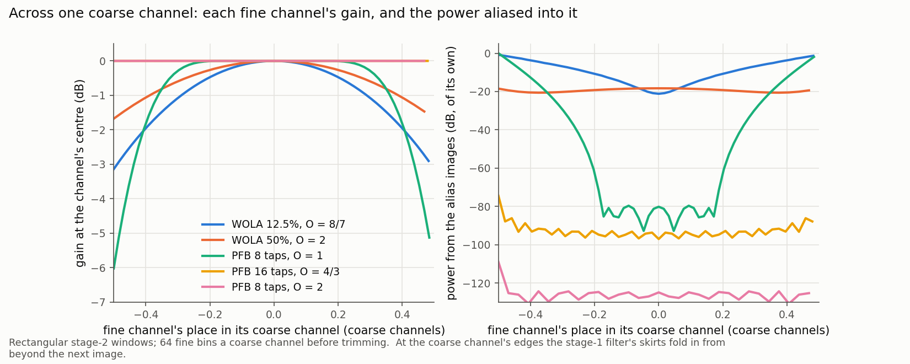
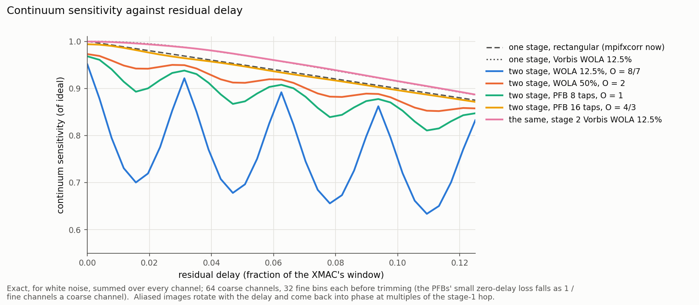
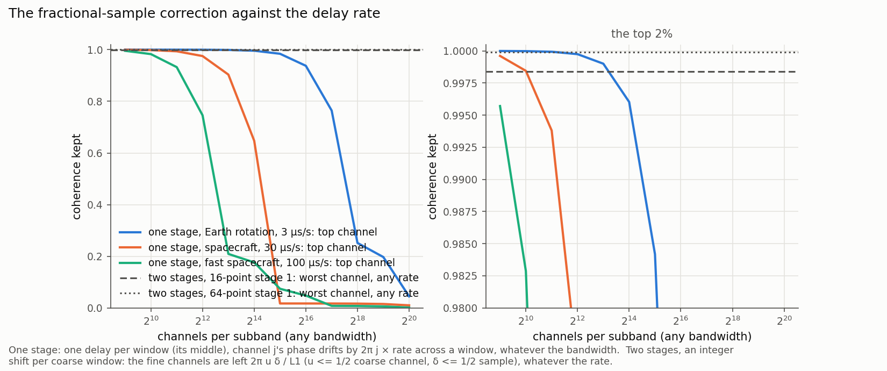

# Two-stage channelisation: analysis and implementation plan

**Status: plan, nothing implemented yet.**  The numbers come from `two_stage.py` and the plots
from `plot_two_stage.py` (`python3 two_stage.py`, `python3 plot_two_stage.py`, from `fft-fusion/`).

## In short

- **When (the direction, 2026-11-20).**  One stage whenever possible.  Two stages, with a moderate
  number of PFB coarse channels, only where one stage cannot do it:
  - **The resolution needs more channels per subband than one cuFFTDx FFT gives.**  The fused
    kernel is built up to 16384 points, so 8192 channels per real-sampled subband.  This is a
    limit on channels per subband, not on the channel width: recording narrower subbands reaches
    finer channels within it.
  - **The delay rate makes the fractional-sample correction lose.**  One stage loses 0.5% in its
    top channel at about 18k channels per subband at Earth-rotation rates (3 µs/s), so it is fine
    up to the cuFFTDx limit.  But it loses that at 1.8k channels per subband at 30 µs/s and 550 at
    100 µs/s (spacecraft VLBI).
  - **The size of the PFB:** 16 points (8 coarse channels of real data) already keeps the
    fractional-sample loss under 0.2% in the worst fine channel (Delay accuracy).  In practice the
    stage-2 FFT sets the number: Nc of at least O × (channels per subband) / 16384.

- **Why.** The fractional-sample correction uses one delay per FFT window (its middle), in
  fft-fusion and in mpifxcorr.
  Across a window channel j's phase then drifts by 2π j × (delay rate), whatever the bandwidth.
  At an Earth-rotation delay rate (3 µs/s) that costs 6% of the top channel's coherence at 65536
  channels per subband, and nearly all of it at 2^18 and beyond; at spacecraft rates, from a few
  thousand channels per subband.  A coarse first stage with an integer shift per coarse window
  leaves only the fractional part within a coarse channel, under 0.2% loss with a 16-point PFB,
  whatever the rate.  It also replaces one long FFT (the fused kernel stops at 16384 points) with
  short ones.
- **Should the first stage be WOLA and the second not?**  The second stage needs no overlap.  It
  runs on each coarse channel's continuous series, and back-to-back windows use every coarse sample
  once, so they lose no sensitivity.  A taper there only buys fine-channel leakage, the same trade
  as `--wola` today.  **A WOLA first stage works, with a catch.**  Its response droops across the
  coarse channel and its skirts are broad, so the fine channels near a coarse channel's edges
  alias in the neighbouring coarse channels' signal: −1 dB (12.5% taper) to −18 dB (50%) at the
  edge, even oversampled.  That costs 3-5% of continuum sensitivity, more at a residual delay.
  A line leaks no more power into other coarse channels than one WOLA FFT at the coarse
  resolution would, but it lands as a sharp ghost about O coarse channels away (up to −5.7 dB with
  a 12.5% taper) instead of broadening the neighbouring channels.
- **What removes the ghosts: an oversampled polyphase filter bank (PFB) as the first stage.**
  - Oversampled by O = 4/3 with 16 taps, or O = 2 with 4-8 taps.
  - Keep the central 1/O of each coarse channel's fine bins.
  - The alias images fall to −44 dB (8 taps, O = 4/3) and below −63 dB (the others).
  - The fine channels are flat across the coarse channel.
  - Continuum sensitivity within 0.15 / K of ideal, K fine channels a coarse channel (0.3% at
    K = 48), with the same leakage as one rectangular FFT.
  - A Vorbis WOLA second stage gives the same leakage and sensitivity as `--wola` today.
  - Two stages cost 2.2-3x the FFT arithmetic of one long FFT, plus a round trip of the coarse
    series through DRAM.
- **Against fewer channels in one stage** (the question that decides WOLA or PFB): with a WOLA
  first stage a line leaks exactly the same power into each other coarse channel as one WOLA FFT
  at the coarse resolution.  But it lands as a sharp ghost about O coarse channels from the line,
  not as a broadened neighbour; elsewhere the leakage is far lower.  A PFB removes the ghosts.
- **Decisions** at the end: the second stage is rectangular, two stages are an option for about
  2k-4k channels and up, DiFX's conventions are as assumed, and channel counts need not be powers
  of two.  Still open: WOLA or PFB for the first stage (both kept as options), and the oversampling.

## The design

Real-sampled band of B MHz (2B samples/s); the final channel count nchan; Nc coarse channels.

| stage | what | per |
|---|---|---|
| 1 (coarse kernel) | decode, integer delay shift, fringe rotation (per sample, as now); WOLA window (P = 1) or PFB weights on P × L1 samples, folded to L1 = 2 Nc; real FFT of L1 points; per coarse channel the oversampling derotation and the delay's phase at the channel's centre | coarse window: every H samples, O = L1 / H |
| DRAM | the coarse series, FP16, `[ant][band][coarse channel][coarse sample]` | |
| 2 (fine kernel) | N2-point FFT of N2 consecutive coarse samples; keep the central K = N2 / O bins; optionally the residual delay phase's window mean per fine channel; scale | stage-2 window = the XMAC's window |
| DRAM | FP16 spectra in the staged XMAC's order (`halfIndex`), as the end-to-end kernel writes them now | |
| XMAC | the staged XMAC, unchanged | |

- **The channel grid.**  An even-stacked stage 1 (a plain real FFT, coarse centres at c × B / Nc,
  c = 0 … Nc) with the fine bins k = −K/2 … K/2 − 1 of each coarse channel gives fine channels at
  j × B / nchan, j = 0 … nchan − 1, which is one long FFT's bin grid (and, I believe, DiFX's).  The DC and
  Nyquist coarse channels contribute only their in-band halves; nchan = Nc × K.
- **Channel counts.**  O = L1 / H = N2 / K must hold with H, N2 and K whole numbers.  With nchan
  and Nc both powers of two, K is one too, so O must be a power of two: O = 2 (or 1, which
  aliases).  O = 4/3 makes K, and so nchan, a multiple of 3 (3072, 12288, 49152, …); O = 8/7 a
  multiple of 7.
- **Where the delay is corrected.**
  - **Stage 1:** an integer-sample shift per coarse window, and the fractional part δ at each coarse
    channel's centre f_c.  Coarse channel c's sample n is multiplied by e^{−2πi f_c δ(t_n)}.
  - **The residual:** fine channel u coarse channels from the centre (|u| ≤ ½) is left a phase
    2π u δ / L1, with |δ| ≤ ½ sample.  It is bounded whatever the delay rate or the channel count
    (Delay accuracy).
  - **Stage 2 (optional):** can remove the residual's mean over each window, per fine channel.
  - **The fringe rotation** (the LO term) stays per sample, before stage 1.
- **A PFB does not affect the correction's correctness.**  It is a linear, time-invariant filter,
  the same at every station, so a delay is a phase e^{−2πi f δ} after it as before it, and the
  phase applied is exact at each channel's centre.
  - **Checked by simulation:** a two-stage PFB on a delayed signal leaves exactly 2π u δ / L1
    (to a few mrad) and full coherence for a static delay.
  - **The one rule:** a coarse sample's time is the centre of the whole P × L1-sample PFB window,
    its group delay, not the start of the window or of the L1-point fold.  That matters between
    stations only if they use different PFBs.

## Is WOLA the right first stage?

The two stages together make each fine channel's response the product of the stage-1 window's
response H1(f) and the stage-2 window's.  The stage-2 response repeats every 1/H in frequency (the
coarse sample rate), so whatever H1 passes at f ± m/H lands in the same fine channel.
- **The oversampling.**  Oversampling by O and keeping only the central 1/O of each coarse
  channel's fine bins puts the nearest image O − 0.5 coarse channels from the centre.
- **The window.**  H1 must be down by then.

A short-tapered WOLA window has the response of a rectangular window with slightly lower sidelobes:
it is still above −20 dB a whole coarse channel out.  A PFB (a windowed sinc P × L1 samples long,
folded into the FFT) is flat to the kept edge and falls to its stopband by O − 0.5.

What that does to the fine channels, across one coarse channel:
- **WOLA:** the gain droops by 1.7-3 dB at the edges, and the edge channels take −1 to −18 dB of
  their power from the images.
- **A critically sampled PFB (O = 1):** flat inside, but at its edges two frequencies one coarse
  channel apart land in the same fine channel equally (−6 dB each).  Oversampling is what removes
  that, not taps.
- **The oversampled PFBs:** flat, with images at −90 dB (16 taps, O = 4/3) or below.

A line near a coarse channel's edge shows the difference.  With a WOLA first stage it appears
again O coarse channels away on each side: at −11.5 / −12.9 dB with the 12.5% taper, and
−21 / −33 dB with the 50% taper (those images are at ±2 coarse channels, beyond the plot).  With
the oversampled PFB the images are at −100 dB or below (16 taps, O = 4/3; −68 dB with 4 taps at
O = 2), and the fine channels see the line as one rectangular FFT would.

## Leakage against frequency offset: two stages against fewer channels

The question that matters for a WOLA first stage: is a line's leakage, at a given frequency offset,
worse than with one WOLA FFT at the coarse resolution, the smaller channel count one would have
used before?

The setup: 64 coarse channels, Vorbis 12.5% WOLA windows, O = 8/7 (56 fine channels a coarse
channel), rectangular stage 2.  For two stages, each offset is shown for the worst and the median
of a coarse channel's fine channels, each normalised to its own peak.
- **Within one coarse channel of the line,** two stages are 10-40 dB better.  One coarse WOLA
  channel is still in its main lobe there.
- **Further out,** a two-stage fine channel is generally 15-35 dB below the coarse response's
  sidelobes (−30 to −55 dB, against −13 to −20 dB).
- **Except at the alias ghosts.**  These are narrow, one fine channel wide, at ±O and ±2O coarse
  channels from the line.  For the worst-placed fine channels they reach −3 dB and −12 dB; for the
  median channel, about −25 dB.

How large a ghost is depends on where the line falls in its coarse channel.  Two stages: the
largest response more than half a coarse channel from the line.  One stage at 64 channels: the
line's response in that same coarse channel (`python3 two_stage.py ghost`):

| line's position from its coarse centre | WOLA stage 1: ghost, offset (coarse channel) | one stage, 64 channels, the same coarse channel | PFB 32 taps stage 1: largest beyond half a coarse channel |
|---|---|---|---|
| 0.0 | −19.4 dB at −1.14 (−1) | −19.4 dB | −105 dB |
| 0.1 | −13.1 dB at +1.15 (+1) | −13.1 dB | −34 dB (stage-2 sidelobe, own coarse channel) |
| 0.2 | −9.0 dB at +1.14 (+1) | −9.0 dB | −40 dB |
| 0.3 | −5.7 dB at +1.15 (+1) | −5.7 dB | −38 dB |
| 0.4 | −11.5 dB at +1.14 (+2) | −11.5 dB | −30 dB |
| 0.45 | −11.0 dB at +1.14 (+2) | −11.0 dB | −32 dB |
| 0.5 | −10.6 dB at −1.14 (−1) | −10.6 dB | −121 dB |

**So the answer is no more leakage, but in a different place.**
- **The power is identical.**  A line puts exactly the same power into each other coarse channel
  as one WOLA FFT at the coarse resolution does: the two columns agree to 0.1 dB.  It has to, since
  that power is the stage-1 window's response to the line, seen from the other coarse channel.
- **What changes is where it lands.**  One stage spreads it over the whole of that coarse channel,
  a line broadened into its neighbours at about the right frequency.  Two stages fold it into one
  fine channel about O coarse channels from the line: a sharp spurious line at the wrong frequency.
  For a line 0.3 coarse channels from its coarse centre, the −5.7 dB that one stage shows in the
  adjacent channel (0.7 coarse channels away) appears in two stages as a −5.7 dB ghost 1.15 coarse
  channels away.
- **Everywhere else two stages are much cleaner,** since the fine channels resolve what one coarse
  channel would have smeared.
- **The ghosts are the ~5% continuum loss.**  The same folded power, as noise, is the continuum
  sensitivity loss in the table above (0.951 with the 12.5% WOLA stage 1).
- **For continuum, or lines well inside the band of interest,** a WOLA first stage is no worse
  than the coarse channel count was.  For line work, a strong line anywhere can put a ghost
  several dB down one coarse channel away.  A PFB first stage removes the ghosts (everything
  beyond half a coarse channel at −30 dB or below, the rectangular stage 2's own sidelobes), for P
  multiply-adds a sample.

## Sensitivity

The continuum sensitivity is exact, not estimated.
- **The map.** The script builds the whole linear map from a circular stream of input samples to
  every kept fine channel and stage-2 window.  The summed cross-power's SNR for white noise is then
  tr(G) / ‖G‖_F, with G the map times its conjugate transpose.  That includes the correlations
  between fine channels that aliasing and oversampling create.
- **At a residual delay,** each channel keeps |(A D A^H)_jj| of its correlation, D the delay; the
  phase slope is the fringe fit's.
- **The check:** the one-stage rows reproduce the README's window-design table.

All values relative to the ideal:

| design | O | SNR at delay 0 | at W/64 | at W/16 | edge gain | alias, worst / median | leakage beyond 5 / 20 (median) |
|---|---|---|---|---|---|---|---|
| one stage, rectangular (mpifxcorr now) | 1 | 1.000 | 0.984 | 0.938 | 0 dB | — | −16.9 / −23.0 dB |
| one stage, Vorbis WOLA 12.5% (`--wola`) | 8/7 | 1.000 | 0.997 | 0.957 | 0 dB | — | −23.4 / −59.2 dB |
| two stage: rectangular stage 1 | 1 | 1.000 | 0.627 | 0.938 | −3.9 dB | +1.7 / −6.3 dB | −6.9 / −7.1 dB |
| two stage: WOLA 12.5% | 8/7 | 0.951 | 0.700 | 0.892 | −3.1 dB | −0.8 / −8.7 dB | −8.7 / −9.1 dB |
| two stage: WOLA 25% | 4/3 | 0.930 | 0.780 | 0.873 | −2.5 dB | −4.2 / −11.8 dB | −10.9 / −11.7 dB |
| two stage: WOLA 50% | 2 | 0.973 | 0.942 | 0.919 | −1.7 dB | −18.3 / −19.4 dB | −15.5 / −18.7 dB |
| two stage: PFB 8 taps | 1 | 0.968 | 0.893 | 0.908 | −6.0 dB | 0.0 / −41.9 dB | −17.3 / −24.2 dB |
| two stage: PFB 8 taps (46 dB) | 4/3 | 0.994 | 0.982 | 0.935 | −0.1 dB | −44.5 / −51.3 dB | −17.2 / −25.1 dB |
| **two stage: PFB 16 taps (85 dB)** | **4/3** | **0.994** | **0.981** | **0.934** | **0.0 dB** | **−74.5 / −93.2 dB** | **−17.2 / −25.0 dB** |
| two stage: PFB 32 taps (74 dB) | 8/7 | 0.995 | 0.979 | 0.934 | 0.0 dB | −58.4 / −86.5 dB | −17.1 / −24.5 dB |
| **two stage: PFB 4 taps (65 dB)** | **2** | **0.994** | **0.984** | **0.935** | **0.0 dB** | **−63.4 / −70.2 dB** | **−17.3 / −25.8 dB** |
| two stage: PFB 8 taps (123 dB) | 2 | 0.993 | 0.984 | 0.933 | 0.0 dB | −109 / −126 dB | −17.2 / −25.6 dB |
| **PFB 16 taps, O = 4/3, stage 2 Vorbis WOLA 12.5%** | **4/3** | **0.999** | **0.996** | **0.958** | **0.0 dB** | **−74.3 / −93.2 dB** | **−23.3 / −58.2 dB** |

How to read the table:
- **Model size.** 64 coarse channels.  The response figures use 64 fine bins a coarse channel
  before trimming; the sensitivities use 32 (K = 24, 28 or 16 kept).
- **Delays.** W is the stage-2 window, which is the XMAC's window.
- **The PFB's dB figure** is the stopband Kaiser's formula gives for its taps and transition.
- **The PFBs' zero-delay loss is an edge effect.** The rectangular stage-2 window's sidelobes reach
  across the coarse channels' edges, so the loss falls as 1 / K: 0.10-0.15 / K, measured at K = 6,
  12 and 24.  That is under 0.3% at K = 48 and negligible at the K of thousands of channels.
- **The WOLA and critically sampled designs' losses level off instead** (3-5%): that is their
  aliasing, which no N2 removes.

### What the continuum loss is, and what it is measured against

The metric:
- **What is summed.** The visibilities summed with equal weight over every channel and window, the
  continuum as channel averaging forms it.
- **The inputs.** White noise with a weak common signal.
- **The reference.** The ideal SNR from the same samples.

One stage scores exactly 1.000 at zero delay at any channel count.  A rectangular DFT is unitary,
and Vorbis WOLA weights add to one in power, so the channel width does not matter.

Two stages lose for two reasons when the first stage is WOLA:
- **Two frequencies share one output sample (most of the loss).**  A fine channel near a coarse
  edge contains its own frequency and, almost as strongly, an alias frequency O coarse channels
  away.
  - Both carry correlated signal, but the two components' noise also multiplies each other in
    X Y*.  That adds noise and no signal.
  - The two components are worth two independent samples, but they come out as one.
  - Separate channels give a noise variance of a² + b²; one channel holding both gives (a + b)².
  - This loss cannot be undone by weighting the channels.
- **The band is weighted unevenly (1.4 of the 4.9%).**  Each frequency's total weight over all the
  fine channels it appears in (its own and its alias) ranges 0.62-1.12 across a coarse channel.
  Summing such a band loses mean / rms = 0.986, the frequency-domain counterpart of a Tukey taper's
  uneven time weights.

**The loss does not depend on the number of coarse channels.**
- **Coarse channels:** with a WOLA first stage it is 0.9506 at 32, 64 and 128 coarse channels of
  real data (L1 = 64, 128, 256; 12.5% taper, O = 8/7), and 0.9694 for a 50% taper at O = 2.  The
  window is a fixed fraction of L1, so its response, in coarse channels, has the same shape at
  any L1.
- **Fine channels:** at 12.5% it does not depend on them either (0.9506 at K = 14 and 28).
- **The levers are the stage-1 filter's shape and the oversampling:** 0.951 at 12.5% (O = 8/7),
  0.930 at 25% (O = 4/3), 0.973 at 50% (O = 2), and 0.995 or better with a PFB.

(One stage loses nothing at zero delay with Vorbis tapers: 1.0000 against rectangular windows at
64, 256 and 1024 points, as the tapers are power-complementary; a Tukey 12.5% taper loses 0.65%.)

A PFB keeps each fine channel to one frequency range, so neither happens.  What is left is the
rectangular stage 2's sidelobes reaching across the coarse edges, 0.15 / K.

Against which single stage?  At a residual delay τ (input samples; the coarse window is 64
samples, the fine resolution 64 × 28 = 1792 channels):

| channelisation | τ = 0 | 1 | 4 | 16 |
|---|---|---|---|---|
| one stage, 64 channels, rectangular | 1.000 | 0.984 | 0.938 | 0.750 |
| one stage, 64 channels, Vorbis WOLA 12.5% | 1.000 | 0.997 | 0.957 | 0.743 |
| one stage, 1792 channels, rectangular | 1.000 | 0.999 | 0.998 | 0.991 |
| one stage, 1792 channels, Vorbis WOLA 12.5% | 1.000 | 1.000 | 1.000 | 0.999 |
| two stage, WOLA 12.5% stage 1, 64 × 28 | 0.951 | 0.948 | 0.918 | 0.774 |
| two stage, PFB 32 taps stage 1, 64 × 28 | 0.995 | 0.995 | 0.994 | 0.989 |

- **One stage, fewer channels:** at zero delay the same as more channels (1.000).  At a residual
  delay it loses more, because its window is shorter: about τ / L of the correlation for an
  L-sample rectangular window.
- **Two stages, WOLA first stage:** about 5% below one stage at the same final width.  It inherits
  the coarse window's sensitivity to residual delay, because the aliased and coarse-edge
  components decorrelate like the 64-sample window.  So it is close to one stage at the coarse
  resolution: 5% worse at small delays, slightly better (0.774 against 0.743) at 16 samples.
- **Two stages, PFB first stage:** behaves like one stage at the final resolution (0.989 against
  0.991 at 16 samples), less 0.15 / K.

At a residual delay the oversampled PFBs follow one rectangular FFT of the same resolution: the
composite fine-channel filter is as long as the stage-2 window, so short stage-1 windows do not
make it more delay-sensitive.  The aliasing designs do worse and oscillate: an alias image's phase
turns with the delay and comes back into phase at multiples of the stage-1 hop.  With a Vorbis
stage 2 the PFB matches `--wola`.

## Delay accuracy

**One stage.**  The fractional-sample correction uses one delay per window, its middle (fft-fusion
and mpifxcorr).
- **The drift:** channel j (frequency j B / nchan, window nchan / B long) drifts in phase by
  2π j × (delay rate) across the window, and keeps sinc(j × rate) of its amplitude.
- **Channels, not bandwidth:** the loss depends on the channel count per subband, not on the
  bandwidth.

Coherence kept, top channel / band average:

| channels per subband | 3 µs/s (Earth rotation) | 30 µs/s | 100 µs/s |
|---|---|---|---|
| 1024 | 1.0000 / 1.0000 | 0.9985 / 0.9995 | 0.9829 / 0.9943 |
| 4096 | 0.9998 / 0.9999 | 0.9754 / 0.9918 | 0.7461 / 0.9125 |
| 16384 | 0.9960 / 0.9987 | 0.6474 / 0.8766 | 0.1762 / 0.4238 |
| 65536 | 0.9376 / 0.9790 | 0.0172 / 0.3699 | 0.0479 / 0.1477 |
| 262144 | 0.2516 / 0.7169 | 0.0167 / 0.1280 | 0.0076 / 0.0476 |
| 1048576 | 0.0447 / 0.2583 | 0.0100 / 0.0408 | 0.0013 / 0.0146 |

The loss reaches 0.5% (top channel / band average) at these channel counts per subband:

| delay rate | channels per subband |
|---|---|
| 3 µs/s | 18400 / 31900 |
| 30 µs/s | 1840 / 3190 |
| 100 µs/s | 550 / 960 |

**Two stages.**  An integer shift per coarse window, and the fractional part corrected at each
coarse channel's centre, leave fine channel u (|u| ≤ ½ coarse channel) a phase 2π u δ / L1, with
|δ| ≤ ½ sample.  As δ sweeps a sample (the delay drifting), the channel keeps sinc(u / L1).  That
holds whatever the delay rate or the channel count, so the PFB can be small:

| stage-1 FFT points L1 (L1 / 2 coarse channels of real data) | loss, worst fine channel / average |
|---|---|
| 8 | 0.64% / 0.21% |
| 16 | 0.16% / 0.05% |
| 32 | 0.04% / 0.01% |
| 64 | 0.01% / 0.003% |

- **The bound holds:** a simulated two-stage PFB (16 taps, O = 4/3; L1 = 8, 16, 32) on a delayed
  signal leaves exactly the predicted phase.
- **Stage 2's optional correction** (the residual's mean per window and fine channel) reduces it
  further when δ changes slowly.
- **What sets the coarse channel count in practice** is the stage-2 FFT, N2 = O × (channels per
  subband) / Nc, which must fit cuFFTDx (16384 as built here).  65536 channels per subband at
  O = 4/3 need Nc ≥ 6 (so 8), and 2^20 need Nc ≥ 86 (so 128).

## Cost

Floating-point operations per input sample:
- **One FFT of N points:** about 2.5 log2 N.
- **Two stages:** about 2.5 O log2(N O) for the two FFTs, plus 2 P O for the PFB's weights.

| channels | one stage | PFB 16, O = 4/3 | PFB 4, O = 2 | PFB 8, O = 2 |
|---|---|---|---|---|
| 8192 | 35 | 91 | 91 | 107 |
| 65536 | 42.5 | 101 | 106 | 122 |
| 1048576 | 52.5 | 114 | 126 | 142 |

- **Arithmetic** is about 2-3x the FFT work of one FFT.  The FFT is not the whole kernel: on the
  A100 the end-to-end kernel is bound by the FMA pipe and the sincos calls, not the FFT alone
  (README.md), so the measured ratio will be smaller.
- **DRAM:** the coarse series, FP16, written and read once: 8 × O bytes per final channel value,
  against 8 bytes (FP16 spectra written, read by the XMAC) now: 2.3x the traffic at O = 4/3, 3x at
  O = 2.  At 10 stations, 8 bands of 64 MHz, that is 55 GB/s in real time, 3% of an A100.
- **Shared memory:** a stage-1 block decoding G consecutive coarse windows needs (G − 1) H + P L1
  samples, each decoded once and used by P × O windows.
- **A later option:** where N2 × Nc complex values fit in shared memory (nchan up to about
  8-16k at FP16), both stages fit in one block with no DRAM round trip.  For those channel counts
  the existing single-stage kernel is already accurate, so this is an optimisation, not the
  first target.

## Implementation plan

1. **Python reference.**  A numpy model of the whole two-stage chain from a sample series (both
   stations, delays and rates), checked against `two_stage.py`'s predicted responses (a tone
   sweep: gain, alias levels) and against one long FFT where they should agree.  It is the GPU
   kernels' reference for small cases.
2. **Stage-1 kernel** (`coarse_inst.cu`, one instantiation per L1 and P, cuFFTDx; P = 1 is a WOLA
   window, P > 1 a PFB, so both first stages are the same kernel with a different weight table).
   - **Block:** G consecutive coarse windows of one (antenna, band).
   - **Input:** the packed data decoded once into shared memory with the lean decode, with an
     integer shift per coarse window.
   - **Per sample:** fringe rotation (as now).
   - **Per coarse window:** the P-tap fold to L1 samples, then a real FFT of L1 points.
   - **Per coarse channel:** derotation × delay phase at the channel's centre, then a scale.
   - **Output:** FP16, time fastest per coarse channel.
   - **History:** the PFB needs (P − 1) L1 samples before each subint, from the previous one (in
     mpifxcorr, from the datastream buffer).
   - **Invalid data:** coarse samples whose input is invalid are written as zeros.
3. **Stage-2 kernel.**
   - **Per (antenna, band, coarse channel, stage-2 window):** an N2-point complex FFT (cuFFTDx,
     batched in the block), keeping K bins.
   - **Per fine channel (optional):** the window mean of the residual delay phase.
   - **Correction:** none is needed.  The PFB's passband ripple is under 0.001 dB at 16 taps
     (O = 4/3) and 0.011 dB at 4 taps (O = 2); only the 8-tap O = 4/3 design reaches 0.09 dB.
   - **Output:** FP16 into the staged XMAC's layout, unchanged downstream; a stage-2 window's data
     weight is the fraction of its coarse samples that were valid.
4. **fusebench `--two-stage Nc,P,O`**, an option beside the single-stage kernel (selected for about
   2k-4k channels and up, as DiFX would select it).
   - **Timing:** against the single-stage kernel up to 8192 channels and cuFFT beyond.
   - **Checks:** a tone sweep against `two_stage.py`; a double-precision reference of the same
     chain on a few spectra; the whole chain through the staged XMAC against gpudifx's XMAC (as
     now); and a large synthetic delay rate, two stages against one.
5. **Benchmarks.** nchan 4k-1M, Nc 16/32/64, (P, O) in {(16, 4/3), (4, 2), (8, 2)}, on the 2070,
   the A100 and the RTX PRO 6000.
6. **Later.**
   - Both stages in one block for small N2 × Nc.
   - Zoom bands by skipping the coarse channels not needed: stage 2 runs only where a zoom band is.
   - The phase-centres work (`../../phase-centres`), which wants exactly these fine channels.

## Decisions

Answered (2026-11-20):
- **The second stage is rectangular.**
- **DiFX's channels are the long FFT's bins,** with DC in channel 0.  The even-stacked design above
  gives exactly that grid.
- **mpifxcorr also corrects the fractional sample once per FFT window,** so the delay-rate
  analysis applies to it as to fft-fusion.
- **Two stages are an option, not the one path.**  One stage whenever possible.  Two stages, with
  a moderate number of PFB coarse channels, when the resolution needs more channels per subband
  than one cuFFTDx FFT gives, or when the delay rate makes one stage's fractional-sample
  correction lose (spacecraft VLBI); see In short.

- **DiFX can use channel counts that are not powers of two,** so any oversampling will do
  (O = 8/7: multiples of 7; O = 4/3: multiples of 3).

Still open:
1. **The first stage: WOLA or a PFB,** both kept as options for now (one kernel, different weight
   tables).  WOLA gives the ghosts and the ~5% continuum loss above; a PFB costs P multiply-adds a
   sample more and has neither.
2. **The oversampling, which sets the channel counts.**  O = L1 / H = N2 / K must be whole-number
   ratios.
   - The 12.5% WOLA (O = 8/7) makes channel counts multiples of 7 (3584 = 64 × 56, 7168, …).
   - O = 4/3 makes them multiples of 3.
   - Powers of two need O = 2: a 50% WOLA taper, or a 4-8-tap PFB, at 2x the stage-1 FFTs and the
     coarse series' traffic.
