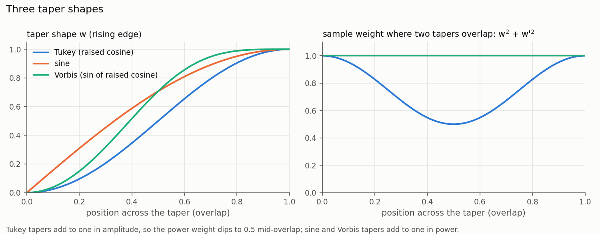
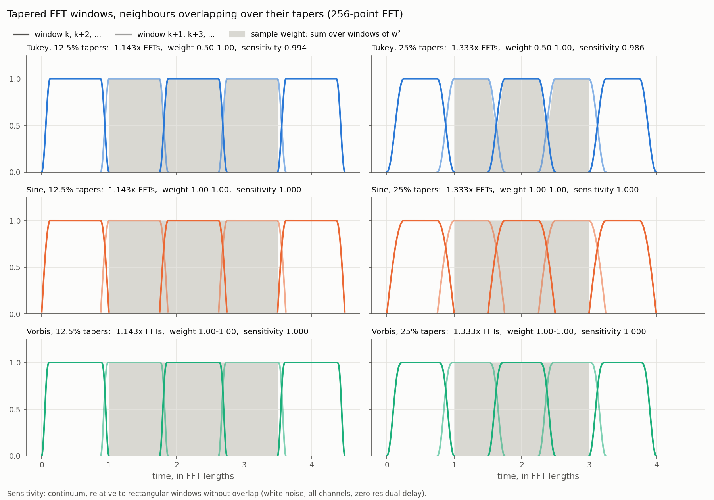
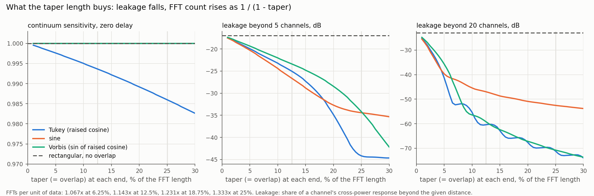
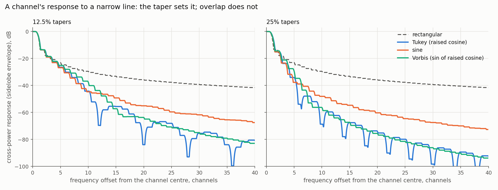
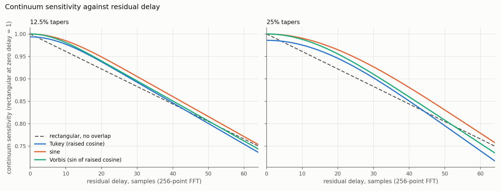

# Window design

_Moved from `fft-fusion/README.md` in the 2026-11-21 reorganisation, unchanged but for the heading levels. `results-local/` paths are in `fft-fusion/` (runs of `run-xmac.sh` and `run-staged.sh`: `xmac/`). Section names in quotes refer to these docs: see [the findings index](../FINDINGS.md)._

All the designs here overlap neighbouring windows over exactly their tapers (with 12.5% tapers,
consecutive windows start 0.875 FFT lengths apart). Three taper shapes, with x running from 0
to 1 across the taper:

- **Tukey**, the raised cosine 0.5 (1 - cos πx).
- **Sine**, sin(πx/2).
- **Vorbis**, sin(π/2 · raised cosine). This is the taper of the window used in Ogg Vorbis,
  and the `--wola` default.

Where two windows overlap, the cross-power weights each sample by the sum of the squares of the
two tapers.
- **Tukey tapers add up to one in amplitude, not in power**, so that weight dips to 0.5 in the
  middle of each overlap. This costs continuum sensitivity: 0.6% at 12.5% tapers, 1.4% at 25%.
  Shorter tapers lose less, but no Tukey width loses nothing, because the loss comes from the
  shape.
- **Sine and Vorbis tapers add up to one in power**, so every sample has weight 1 and there is
  no loss at any taper length.
- **The Vorbis taper is also smooth at both ends**, like the Tukey taper, so its far sidelobes
  fall off as fast as Tukey's. The sine taper's sidelobes fall off more slowly.

Longer tapers cut the leakage further and cost more FFTs, 1 / (1 - taper). At 12.5% the near
leakage (beyond 5 channels) is much the same for all three shapes, -23 to -27 dB, and the far
leakage (beyond 20 channels) is -59 to -60 dB for Tukey and Vorbis, against -47 dB for sine.
Between about 18% and 25%, Tukey's near leakage drops faster than the others' (-44 dB at 25%,
against -34 dB for sine and Vorbis), but Tukey then loses 1.4% of sensitivity.

Window shape alone sets how much correlation survives a residual delay; overlap sets the
sensitivity at zero delay. With 12.5% tapers each shape beats rectangular windows over a range
of residual delays (256-point FFT): Tukey from 2 to 43 samples, Vorbis from 1 to 52, sine from
1 to 69. The sine taper keeps the most correlation.

`window_response.py` gives these numbers for a 256-point FFT (continuum sensitivity relative to
rectangular windows without overlap; white noise; all channels). The spectral figures do not
depend on the FFT length.

| design | FFTs | sensitivity, delay 0 / 4 / 16 samples | leakage beyond 5 / 20 channels |
|---|---|---|---|
| rectangular, no overlap (mpifxcorr now) | 1.000 | 1.000 / 0.984 / 0.938 | -16.9 / -23.0 dB |
| Tukey 12.5% | 1.143 | 0.994 / 0.991 / 0.955 | -25.0 / -60.4 dB |
| sine 12.5% | 1.143 | 1.000 / 0.997 / 0.965 | -26.6 / -47.2 dB |
| Vorbis 12.5% (`--wola`) | 1.143 | 1.000 / 0.997 / 0.957 | -23.4 / -59.2 dB |
| Tukey 25% | 1.333 | 0.986 / 0.984 / 0.960 | -44.2 / -71.2 dB |
| sine 25% | 1.333 | 1.000 / 0.998 / 0.977 | -34.4 / -52.8 dB |
| Vorbis 25% | 1.333 | 1.000 / 0.998 / 0.970 | -34.2 / -70.7 dB |
| Tukey 12.5%, hop 0.75 | 1.333 | 0.972 / 0.969 / 0.934 | -25.0 / -60.4 dB |
| Hann, 50% overlap | 2.000 | 0.973 / 0.972 / 0.949 | -53.5 / -83.7 dB |

The "hop 0.75" row places Tukey 12.5% tapers 0.75 FFT lengths apart, so the flat parts of the
overlaps are counted twice (weights 1 to 2). It costs more and does worse on every measure here.

**Choosing.** For no loss of continuum sensitivity at any taper length, use the Vorbis taper.
It keeps the Tukey taper's far-sidelobe suppression. At 12.5% it costs 1.143x the FFTs
(`--wola`). Going to 25% improves the near leakage by about 11 dB and the far
leakage by about 11 dB, for 17% more windows: 10-13% more fused-kernel time on the 2070 (the
"hop 0.75" rows in [station-kernel.md](station-kernel.md) have the same window count). The window is a table of
weights, so the shape costs nothing; only the taper length (the number of windows) does.
All of these are `fusebench` options (`--taper`, `--overlap`, `--window tukey|sine|vorbis`).
