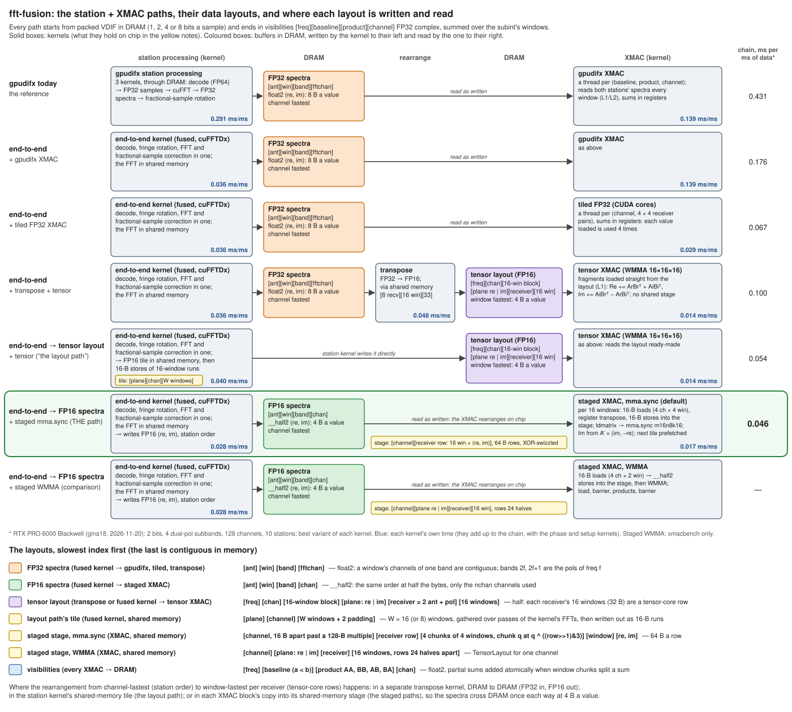

# The station + XMAC paths: what each one does, saves and costs

**Since 2026-11-20 only paths 1, 2 and 6 are in the code** (gpudifx today and gpudifx's XMAC as the
reference, and the staged path, the one kept).  Paths 3, 4, 5 and 7 were retired after these
comparisons and the 108-shape matrix ("The big matrix" in [README.md](../README.md)); this page is
the record of why.

Every path does the same job: from packed VDIF it makes each station's spectra (decode, fringe
rotation, FFT, fractional-sample correction), then cross-multiplies every pair of receivers
(station, polarisation) and sums over the subint's windows (the XMAC).  They differ in where the
spectra live between the two stages, in what layout, and in which kernel rearranges them.

The rearrangement is the crux.  Station processing naturally produces a window at a time,
**channel fastest** (`[ant][win][band][chan]`).  Tensor cores multiply 16 x 16 tiles, and for the
XMAC a tile row must be one receiver's **16 consecutive windows** of one channel, with the
receivers stacked as rows (the tensor layout, `[freq][chan][16-window block][re | im][receiver][16
windows]`).  Someone has to turn channel-fastest into window-fastest-per-receiver.  Each tensor
path puts that work in a different place: a separate kernel (transpose), the station kernel (the
layout path), or the XMAC itself (staged).

Times below are from the diagram's shape (RTX PRO 6000 Blackwell, 2 bits, 4 dual-pol subbands,
128 channels, 10 stations), in ms per ms of data, station + XMAC = chain.  "A value" is one
channel of one window of one band of one station.

**1. gpudifx today (the reference).**  Three station kernels (gpudifx's FP64 decode and fringe
rotation, cuFFT, the fractional-sample rotation), FP32 samples and spectra through DRAM between
them, then gpudifx's XMAC: a thread per (baseline, product, channel) reading both stations'
spectra for every window.
- *Saves:* nothing; it is what we measure against.  It is general (valid flags, autocorrelations,
  every band and channel layout DiFX uses).
- *Costs:* every station step is a DRAM round trip in FP32; the XMAC re-reads each value for
  every baseline and product it is in (2 (N − 1) times, mostly from cache) on the CUDA cores.
- *Measured:* 0.291 + 0.139 = 0.431.

**2. End-to-end kernel + gpudifx XMAC.**  One fused kernel (cuFFTDx) does all the station
processing on chip and writes FP32 spectra once; the XMAC is unchanged.
- *Saves:* the station's intermediate DRAM round trips and two kernels: the station stage is 8x
  faster (0.291 → 0.036).
- *Costs:* nothing extra.  But now the XMAC is 80% of the chain.
- *Measured:* 0.036 + 0.139 = 0.176 (2.5x over gpudifx today).

**3. End-to-end + tiled FP32 XMAC.**  Same FP32 spectra; the XMAC gives each thread a 4 x 4 block
of receiver pairs for one channel, its sums in registers.
- *Saves:* XMAC loads: each value loaded is used 4 times instead of once.  Still exact FP32, no
  layout change, no tensor cores needed.
- *Costs:* still the CUDA cores' FP32 rate, for work that grows as N².
- *Measured:* 0.036 + 0.029 = 0.067 (6.4x).

**4. End-to-end + transpose + tensor XMAC.**  The FP32 spectra go through a transpose kernel
(FP32 → FP16, channel-fastest → tensor layout, via shared memory) into a second DRAM buffer,
which the tensor XMAC (WMMA, FP16 in, FP32 sums) reads with no further rearranging.
- *Saves:* XMAC arithmetic: the tensor cores' FP16 rate is many times the FP32 one, so the XMAC
  itself drops to 0.014 (10x below gpudifx's, 2x below tiled).  The station kernel is untouched.
- *Costs:* a whole extra DRAM pass: 8 B a value written by the station kernel and read by the
  transpose, 4 B written and read again by the XMAC (24 B a value in all, against 8 for the
  layout and staged paths).  The transpose (0.048) costs more than the station kernel and 3x the
  XMAC.  FP16 inputs (spectra scaled by a power of two to keep them in range); a 16-row tile
  wastes products at small N (one tile holds at most 8 stations' pairs).
- *Measured:* 0.036 + 0.048 + 0.014 = 0.100 (4.3x): worse than tiled, all because of the
  transpose.

**5. End-to-end → tensor layout + tensor XMAC (the layout path).**  The station kernel writes the
tensor layout itself.  It gathers W = 16 (or 8) windows of each channel in a shared-memory tile
`[plane][channel][window]` over several passes of its FFTs, then writes each receiver's 16-window
run as 16-byte stores.  The tensor XMAC is the same as in 4.
- *Saves:* the transpose kernel and the FP32 spectra: 4 B a value written once and read once.
  The XMAC gets tensor-core-ready data, so it is the fastest XMAC kernel (0.014).
- *Costs:* the station kernel's tile: more shared memory a block, so lower occupancy (what made
  the layout path lose at 1024 channels in the first whole-chain measurements, in
  [README.md](../README.md)), and a less direct output, so the station kernel slows (0.040,
  against 0.036 for FP32 and 0.028 for FP16 spectra).  It also ties the station kernel to the
  XMAC: the tile depends on the tensor tiling, the kernel has a second output to maintain, and
  any XMAC-side flexibility (zoom bands, stations missing a frequency, single pol) would have to
  be mapped inside the station kernel.
- *Measured:* 0.040 + 0.014 = 0.054 (8.0x).  The fastest chain where the XMAC's share is large
  and the staged path's station saving small: on the RTX PRO 6000 with 1 subband at 128 channels
  from 10 stations and with 4 subbands at 64 stations (by 4-18%), on the 2070 with 1 subband at
  32 stations (1-7%), and on the A100 at 64 stations and up (6% at 64, 25% at 100).

**6. End-to-end → FP16 spectra + staged XMAC, mma.sync (the one path from here on).**  The station
kernel writes FP16 spectra in its own order, (re, im) as `__half2`, nothing rearranged.  Each XMAC
block loads the channels and receivers it needs, 16 windows at a time: 16-byte loads (4 channels
x 4 windows), a 4 x 4 transpose in registers, 16-byte stores into a shared-memory stage (one
64-byte row per receiver and channel: 16 windows x (re, im), XOR-swizzled against bank
conflicts).  Then ldmatrix and mma.sync multiply straight from the stage; the imaginary part
comes from A's pairs turned into (im, −re), and the next 16 windows load during the products.
- *Saves:* everything the layout path saves (4 B a value written and read once, no transpose),
  plus the station kernel's tile: the cheapest station output (0.028, 0.47-0.85x the
  layout-writing kernel across shapes).  The station kernel has one simple output, and the
  layout belongs to the XMAC alone, so DiFX's flexibility goes in one place (the XMAC's copy).
- *Costs:* every XMAC block does the rearrangement itself: loads, register transpose, stores and
  barriers each 16 windows.  That makes the staged XMAC 1.1-2.75x the tensor XMAC kernel alone
  (0.017 against 0.014 here).  The stage's shared memory limits blocks an SM.  Above 32 receivers
  the receivers are split into super-blocks of 64, and each receiver is read once per pair of
  super-blocks it is in, so DRAM reads grow with N.
- *Measured:* 0.028 + 0.017 = 0.046 (9.3x), the fastest chain here.  Fastest in 40 of 54 shapes
  on the RTX PRO 6000, 32 of 36 on the 2070, and on the A100 up to 32 stations.  It loses where
  the XMAC's share is large and the station saving small (above).  Closing its XMAC gap is the
  "Large N" open item in [README.md](../README.md).

**7. FP16 spectra + staged XMAC, WMMA (kept for comparison).**  The same blocks, but the stage
holds separate real and imaginary planes, as in the tensor layout (`[channel][re | im][receiver]
[16 windows]`), and WMMA multiplies from it.
- *Saves:* the same as 6.  WMMA's fragment layouts are opaque, which made it the simpler first
  version.
- *Costs:* the copy must split each `__half2` into the two planes (more stores); the next tile
  could not be prefetched (it needed more than the 128 registers a thread allowed, and spilled).
  The mma.sync version is 1.05-1.24x faster on the 2070 and 1.1-1.4x on the A100 from 10 stations
  up, and replaced it as the default.

## The layouts

Slowest index first; the last is contiguous in memory.  "Receiver" is (station, polarisation),
r = 2 ant + pol; bands 2f and 2f + 1 are the two polarisations of frequency f.

| layout | where | index order | element |
|---|---|---|---|
| FP32 spectra | DRAM: end-to-end (or gpudifx) station kernel → gpudifx XMAC, tiled XMAC, transpose | `[ant][win][band][fftchan]` | `float2` (re, im), 8 B |
| FP16 spectra | DRAM: end-to-end station kernel → staged XMAC | `[ant][win][band][chan]` | `__half2` (re, im), 4 B |
| tensor layout | DRAM: transpose or end-to-end station kernel → tensor XMAC | `[freq][chan][16-window block][re \| im][receiver][16 windows]` | `__half`, a receiver's 16 windows (32 B) a tensor-core row |
| layout path's tile | shared memory, end-to-end station kernel | `[re \| im][channel][W windows + 2 padding]`, W = 16 or 8 | `__half` |
| transpose's tile | shared memory, transpose kernel | `[8 receivers][16 windows][33 channels]` | `float2` |
| staged stage, mma.sync | shared memory, staged XMAC | `[channel][receiver][4 chunks of 4 windows][window]`, chunk q stored at q ^ ((row >> 1) & 3); channels 16 B apart past a multiple of 128 B | `__half2` (re, im), 64 B a row |
| staged stage, WMMA | shared memory, staged WMMA XMAC | `[channel][re \| im][receiver][16 windows]`, rows 24 halves apart | `__half` |
| visibilities | DRAM: every XMAC | `[freq][baseline (a < b)][product AA, BB, AB, BA][chan]` | `float2`, partial sums added atomically when window chunks split a sum |

## Where the numbers come from

The times in the diagram and above: `results-local/gina18-wide-20261120-140632/nbit2-nband8-nchan128-nant10.log`
(`run-wide.sh`, commit 92a16a2, the best variant of each kernel; `results-local/` is not in the
repository), ms per 20 ms subint divided by 20.  Each kernel's time is measured alone; the chain times are measured as chains and agree with
the sums to within the phase and setup kernels.  The ranges across shapes are from the "Wider
shapes" sections of [README.md](../README.md) (RTX PRO 6000, 2070) and "The staged XMAC split by
receiver" (A100).
The diagram is drawn by `plot_xmac_paths.py` (`python3 plot_xmac_paths.py` from `fft-fusion/`).
