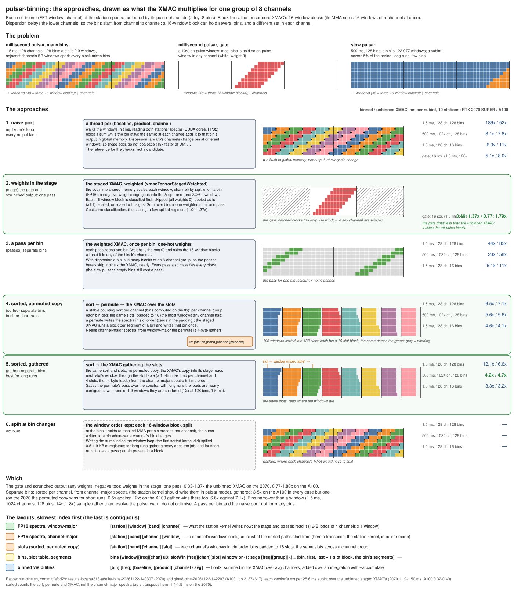

# The pulsar-binning approaches: what each one does, saves and costs

Every approach does the same job as mpifxcorr ([mpifxcorr.md](mpifxcorr.md)): each (FFT window,
channel) product goes into the bin of the pulse phase at that window and channel, and the bins are
written separately or summed with their weights (scrunched; the gate is the two-bin case with
weights 1 and 0).  They differ in how they get the bins past the tensor-core XMAC.

The difficulty is the XMAC's shape.  The staged tensor XMAC ([../../xmac](../../xmac/README.md)) sums
**16 consecutive windows of a channel** in one MMA, for a group of 8 channels a block (4 or 16 at
other station counts).  So all 16 windows must be in one bin, for that channel.  Two things break
that:
- **Short bins.**  A millisecond pulsar's bins last a few windows: at 1.5 ms with 128 channels (4 µs
  windows) a 1/128 bin is 2.9 windows; at 1024 channels (32 µs) it is a third of one.
- **Dispersion.**  The bins slant from channel to channel: at DM 30 and 1.4 GHz adjacent 250 kHz
  channels are 23 µs (5.7 windows) apart.  So a block's 8 channels see different bins in the same
  window, and an order of the windows sorted by bin is different for every channel.

For a slow pulsar (500 ms) bins last hundreds of windows, and a 25.6 ms subint covers only 5% of
the period: long runs, few bins, and most of the output empty.

Times below are from `run-bins.sh` on the RTX 2070 SUPER (150 W, 1500 MHz) and the A100 (OzSTAR),
10 stations, 4 dual-pol 32 MHz bands, DM 30, a 25.6 ms subint: each version's ms per subint over
the unbinned staged XMAC's (2070 1.19-1.50 ms, A100 0.32-0.40 ms), given as 2070 / A100, every run
checked against the host in double.  Full tables: [results.md](results.md).

## The bins (every approach)

A kernel gives every (window, frequency, channel) its bin, once per subint, the same for every station
and baseline (the data are delayed to the geocentre, where the polyco is evaluated): the
phase as a 32-bit fraction of a turn (the window's phase + the channel's dispersion offset, integer
adds, the wrap free), then a binary search over the bin ends (arbitrary, as mpifxcorr's binconfig).
0.04-0.10 ms a subint (3-9% of the XMAC at 10 stations; the search's depth sets it).  The sorted
approaches compute the bins on the fly in their sort instead.

## 1. The naive port

A thread per (baseline, product, channel) walks the windows in time, reading both stations'
spectra on the CUDA cores, and holds a sum while the bin stays the same; at each change it adds
the sum into that bin's output in global memory.  mpifxcorr's loop, nearly line for line.
- *Saves:* nothing; it handles every output kind and is the reference for the checks.
- *Costs:* the CUDA cores' FP32 rate (about 4-6x the tensor XMAC with one sum), and a global
  read-modify-write at every bin change.  Dispersion makes those uncoalesced: a warp's channels
  change bin at different windows (at DM 0 the 128-bin case is 18x faster).
- *Measured:* 189x / 52x (1.5 ms, 128 channels, 128 bins), 8.1x / 7.8x (500 ms, 1024 channels, 128
  bins), 6.9x / 11x (1.5 ms, 16 bins), 5.1x / 8.0x the gate.  The A100's L2 takes the scattered adds
  better.

## 2. Weights in the stage (the gate and scrunched output)

The staged XMAC, weighted (`xmacTensorStagedWeighted`).  A scrunched output is one weighted sum
over all the windows, so it needs no bins in the XMAC at all, only a weight per (window, channel).
The copy into shared memory multiplies each value by sqrt|w| of its bin (the tile feeds both sides
of X1 X2*, so the product gets |w|); a negative weight's sign goes into the A operand's registers,
one XOR a window.  Each block first classifies its 16-window blocks from the bins: skipped (every
weight 0), copied as is (every weight 1), scaled, or scaled with signs.
- *Saves:* the whole binning: one pass, the XMAC's own speed for the scaled windows, and nothing
  at all for the windows whose weight is 0.
- *Costs:* the classification pass over the bins, the FP16 scaling and its extra rounding (weights
  0 and 1 exact), a few spilled registers in the weighted kernel.  With nothing to skip that is
  1.04-1.37x the unbinned XMAC.
- *Measured:* the gate 0.46x / 0.77x (1.5 ms, 128 channels) to 0.70x / 0.96x (1024); 1.10-1.13x /
  1.26-1.33x for the 500 ms pulsar's all-on-pulse subint; 16 bins on - off (negative weights)
  1.24-1.37x / 1.65-1.80x at 1.5 ms, 1.04-1.14x / 1.26-1.34x at 500 ms.  The A100's tensor cores
  are 16x its FP32 rate (the 2070's about 4x), so the copy's extra instructions weigh more there.
- **Why the gate is "faster" than the unbinned XMAC:** it does less.  It skips every 16-window
  block in which all 8 channels' windows have weight 0, which the unbinned XMAC sums anyway.  The
  1.5 ms gate keeps 10% of the period, but dispersion spreads it across a block's channels and the
  blocks are 16 windows wide, so about half the blocks remain (0.46x); at 1024 channels the windows
  are 8x longer against the period, and fewer blocks are all off (0.70x).  An off-pulse subint of the
  500 ms pulsar costs almost nothing.  Per window it does, it is no faster.
- **At high DM the skipping goes**: at DM 300 a block's 8 channels hold on-pulse windows in every
  block, and the gate costs 1.17-1.31x on the 2070 (0.46-0.70x at DM 30).

## 3. A pass per bin (separate bins)

The weighted XMAC once per bin, with a one-hot weight table: each pass keeps one bin and skips the
blocks without it.
- *Saves:* no new kernel: approach 2 reused.
- *Costs:* with dispersion a bin is in many blocks of an 8-channel group, so the passes barely
  skip, and the cost is nearly nbins x the XMAC.  Every pass classifies every block, so the slow
  pulsar's empty bins still cost a pass each.
- *Measured:* 44x / 82x (1.5 ms, 128 channels, 128 bins), 72x / 105x (1024 channels), 23x / 58x
  (500 ms, 1024 channels, 128 bins), 6.1x / 11x (1.5 ms, 16 bins).  Only for a handful of bins.

## 4. Sorted per channel, permuted copy (separate bins, short runs)

Sort each channel's windows by bin into **slots**: a stable counting sort (a warp per frequency and
channel, the bins computed on the fly), then a layout that gives each bin the same slots across a
channel group, padded to 16 (to the most windows any of the group's channels has in it; grey in
the figure).  A permute writes the spectra in slot order, zeros in the padding, and the staged
XMAC (`xmacTensorStagedSorted`) runs a block per segment of a bin, so every 16-slot block it
multiplies is one bin, for every channel, and writes that bin once at the end.
- *Saves:* the bins out of the XMAC's inner loop: it is the plain kernel over more slots, writing
  each bin once.  Short runs cost no more than long ones (the sort makes them long).
- *Costs:* the sort (0.3-1.8 ms), the permute (a pass over the spectra: 3-6 ms on the 2070), the
  padding (2-8% for long runs, 28% at 1.5 ms / 128 channels / 128 bins, 156% at 1024 channels), and
  the output: each bin written per subint.
- **It needs channel-major spectra** (`[station][band][channel][window]`).  From the usual
  window-major order the permute is a 4-byte gather per value, a sector each, and dispersion keeps
  neighbouring channels from sharing them: 17-28 ms.  From channel-major, a channel's windows in a
  bin come in runs and the permute reads them nearly contiguously.  Here a transpose makes them
  (1.4-1.5 ms on the 2070, not counted): the binning's own, or (not needed, see 5) the station
  kernel's in pulsar mode.
- *Measured:* 6.5x / 7.1x (1.5 ms, 128 channels, 128 bins: the best there on the 2070), 14x / 20x at
  1024 channels (bins narrower than a window), 5.6x / 5.6x (500 ms, 1024 channels, 128 bins),
  4.6x / 4.1x (1.5 ms, 16 bins).

## 5. Sorted per channel, gathered (separate bins, long runs)

The same sort and slots without the permuted copy: the XMAC's copy into its stage reads each
slot's window through the slot table (a 16-byte index load per channel and 4 slots, then 4-byte
loads) from the channel-major spectra in time order.
- *Saves:* the permute's pass over the spectra, and its buffer.
- *Costs:* 4-byte loads in the XMAC instead of 16-byte ones: nearly contiguous when a bin's windows
  come in long runs, scattered when the runs are 1-3 windows.
- *Measured:* 4.2x / 4.7x (500 ms, 1024 channels, 128 bins) and 2.9x / 3.9x at 128 channels,
  3.3x / 3.2x (1.5 ms, 16 bins): the best there; 12.1x / 6.6x (1.5 ms, 128 channels, 128 bins), where
  on the 2070 the permuted copy wins and on the A100 gather still does (its 40 MB of L2 against the
  2070's 4 MB).  On the A100 gather is the fastest for every separate-bin case.

**5b. Gathered from the window-major spectra** (`gatherwm`): the same, reading the station kernel's
usual output (the only change a stride), so neither the station kernel nor a transpose changes
anything.  As fast as from channel-major at 1024 channels and low DM (3.8x, 4.2x on the 2070); up to
2x slower at 128 channels (6.1x, 15.2x) and at high DM (neighbouring channels then read different
windows and share no sectors).  With a transpose of its own the binning gets channel-major's speed
for about the XMAC's time more.

**Dispersion does not change the sorted approaches**: each channel is sorted on its own, so the bin
changing at every channel (1.5 ms, 1024 channels, DM 300) costs them nothing (14.1x either way).

## 6. Splitting the 16-window blocks at bin changes (not built)

Keep the window order and split each channel's 16-window block at the bins it holds: a masked MMA
per bin present, the sums written to a bin whenever the channel's bin changes.
- *Would save:* the sort and the permute.
- *Would cost:* writing the sums inside the window loop.  The first version of the sorted XMAC did
  exactly that (each warp following its channel's bin) and spilled 0.5-1.9 KB of registers at KS 2;
  the segment grid (one bin a block, one store at the end) replaced it.  For long runs approach 5
  already does the job; for short runs this costs an MMA per bin present in a block, the passes'
  problem again.

## The output

Separate bins multiply the output by nbins: 128 bins x 1024 channels is 755 MB a subint for 10
stations.  The binned modes can sum `--avg` channels into each output channel (when that covers a
block's channels, its warps add their sums in shared memory first and one writes them) and
`--accumulate` into an integration's sum instead of zeroing every subint.  That helps where the
output is most of the work (the 500 ms pulsar's 128 bins at 1024 channels: 4.2x to 3.1x, its 118
empty bins no longer zeroed each subint); elsewhere the atomic adds it needs cost about what the
smaller output saves.

## Which

| output | regime | approach | 2070 | A100 |
|---|---|---|---|---|
| gate, scrunched (any weights) | any | 2, weights in the stage | 0.33-1.37x | 0.77-1.80x |
| separate bins | long runs: few bins, slow pulsars | 5, sorted, gathered | 2.3-4.5x | 3.0-4.8x |
| separate bins | short runs: many bins of a millisecond pulsar | 4 on the 2070, 5 on the A100 | 6-7x | 6.6x |
| separate bins | bins narrower than a window | warn: such bins sample the pulse rather than resolve it | 14x | 18x |

So one sorted approach, gathered, covers separate bins on the A100, and costs the 2070 2x only for
the shortest runs.  It can read the station kernel's usual window-major output (5b) at some cost
(up to 2x at 128 channels or high DM), or a channel-major copy the binning makes itself: either
way the station kernel stays as it is.

The sorted approaches need channel-major spectra from the station kernel in pulsar mode.  32
stations (where the XMAC is 4x larger) give the same picture or better: the gate 0.33x, 16 scrunched
1.22x, 16 separate 2.45x, 128 separate 6.7x (1.5 ms) and 2.3x (500 ms).

## The layouts

Slowest index first; the last is contiguous.

| layout | where | index order | element |
|---|---|---|---|
| FP16 spectra, window-major | DRAM: the station kernel's output now; read by the stage and passes | `[station][window][band][channel]` | `__half2` (re, im) |
| FP16 spectra, channel-major | DRAM: the sorted approaches' input (here a transpose) | `[station][band][channel][window]` | `__half2` |
| slots | DRAM: the permuted copy (approach 4) | `[station][band][channel][slot]`, a channel's windows in bin order, each bin padded to 16 slots, the same slots across a channel group | `__half2` |
| bins | DRAM | `[window][frequency][channel]` | `uint8` |
| slot table | DRAM | `[frequency][channel][slot]`: the window, or -1 for padding | `int` |
| segments | DRAM | `[frequency][channel group][k]`: (bin, first and last + 1 slot block, the bin's segments) | `int4` |
| stage | shared memory, every XMAC version | as the staged XMAC's ([xmac-paths.md](../../xmac/docs/xmac-paths.md)) | `__half2`, 64 B a row |
| binned visibilities | DRAM | `[bin][frequency][baseline][product][channel / avg]` | `float2` |

## Where the numbers come from

`results-local/ar313-adeller-bins-20261122-140307/table.txt` (the 2070) and
`results-local/gina8-bins-20261122-142203/table.txt` (the A100, job 21374617), both `run-bins.sh` at
commit fafcd29 (`results-local/` is not in the repository), with the 32-station figures from single runs (in
[results.md](results.md), "Step 6").  The diagram is drawn by `plot_binning.py` (`python3
plot_binning.py` from `pulsar-binning/`), its ratios typed in from that table.
