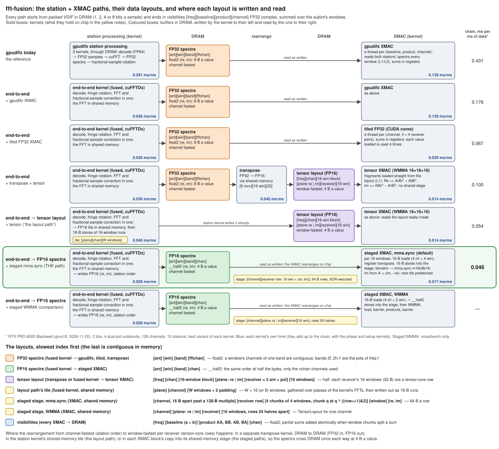

# xmac: the cross-multiply-accumulate

The XMAC stage of gpudifx (each pair of receivers multiplied and summed over a subint's FFT
windows) on the GPU: gpudifx's XMAC (copied verbatim, the reference) against the staged
tensor-core XMAC, which reads FP16 spectra in the station kernel's own order and rearranges them
in shared memory for the tensor cores.  Measured alone (`xmacbench`, from synthetic station
spectra) and after the station stage (`../fft-fusion`'s `fusebench --xmac`, from packed data).
The kernels are in `../common/` (`xmac.cuh`, `xmac.cu`, `xmac_copy.cuh`); the XMAC is the base
that [`../phase-centres`](../phase-centres/README.md) and
[`../pulsar-binning`](../pulsar-binning/README.md) build on.

- [FINDINGS.md](FINDINGS.md): what has been learned, with links to the measurements in `docs/`.
- [BACKLOG.md](BACKLOG.md): what is in progress and still to do.

## The station + XMAC paths

[docs/xmac-paths.md](docs/xmac-paths.md) shows every path from packed data to visibilities in one
diagram: the layout of each buffer, which kernel writes it and which reads it, each kernel's time.
For each path it says what it does, what it saves, and what it costs.  In short: the end-to-end
kernel removes the station stage's DRAM round trips (8x), and the tensor cores make the XMAC
itself 10x faster.  Their catch is the layout: tensor cores want each receiver's 16 consecutive
windows of a channel as a row, and the station kernel produces channels fastest.  That
rearrangement can go in a transpose kernel (an extra DRAM pass, costing more than the tensor
cores save over the tiled FP32 XMAC),
in the station kernel (the layout path: a slower station kernel, tied to the XMAC), or in each
XMAC block's copy into shared memory (the staged path, the one kept: the cheapest station output,
at the cost of a slower XMAC kernel).  The other paths were retired on 2026-11-20 ([FINDINGS.md](FINDINGS.md)).



## Run

Build in the repository root (`make`, see [../README.md](../README.md#building)); then here:

```bash
./xmacbench --help
./xmacbench --nant 10                 # the XMAC stage, 10 stations, 128 channels
./xmacbench --nant 32 --nchan 1024 --nwin 1000
./xmacbench --messy                   # stations with different band layouts
./run-xmac.sh                         # XMAC against the number of stations, alone and in the whole chain
./run-staged.sh                       # the staged XMAC's super-blocks, 4-128 stations
python3 plot_xmac_paths.py            # plots/xmac-paths.svg
```

`run-xmac.sh` runs the whole chain with `../fft-fusion`'s `fusebench --xmac` too (skipped if it is
not built).  Results go to `results-local/<host>-xmac-<stamp>/` and
`results-local/<host>-staged-<stamp>/`.

### Checks

`xmacbench` checks each XMAC against a double-precision reference computed from the same station
spectra (`--check N` (frequency, channel) pairs): gpudifx's FP32 XMAC to 1e-5 rms, the staged
FP16 XMAC to 1e-3 (FP16's rounding of the spectra).  With `--messy` it checks both through their
own band tables / receiver maps, and that the baselines absent from the layout stay zero.
`fusebench --xmac` checks the staged XMAC against gpudifx's XMAC run on the same FP16 spectra
(1e-4 rms: only the order of the FP32 sums differs) and on the FP32 spectra (1e-3: FP16's
rounding of the spectra).

## Code

| file | what |
|---|---|
| `xmacbench.cu` | the XMAC benchmark: station spectra with a common signal, the double-precision check, timing; `--messy` for stations with different band layouts |
| `run-xmac.sh`, `run-staged.sh` | the sweeps against the number of stations |
| `plot_xmac_paths.py` | the paths diagram (`plots/xmac-paths.svg`, [docs/xmac-paths.md](docs/xmac-paths.md)) |
